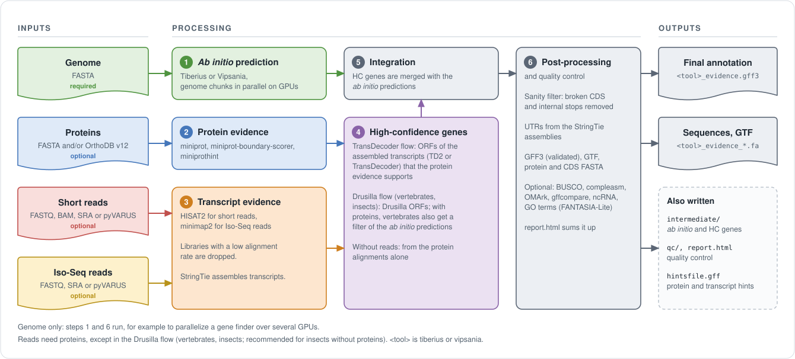
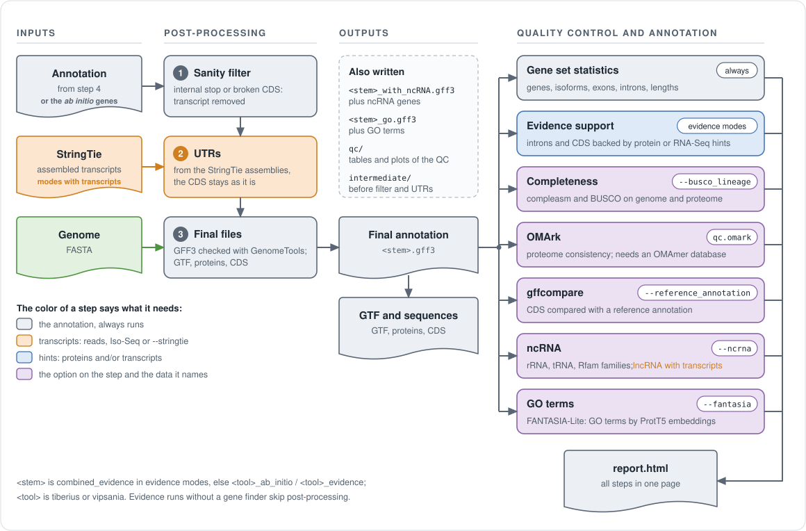

# Paludamentum

<p align="center">
  <br>
  $\color{lightgray}{\tiny\textsf{Logo generated by Gemini}}$
</p>

Authors: Lars Gabriel & Katharina J. Hoff

The paludamentum was the cloak worn by Roman emperors and commanders. This
repository is the cloak around the emperors of the
[Gaius-Augustus](https://github.com/Gaius-Augustus) gene finder family: a
Nextflow pipeline that prepares extrinsic evidence (proteins, RNA-Seq,
Iso-Seq), derives high-confidence genes from it, and integrates them with the
*ab initio* predictions of the deep learning gene finder [Tiberius](https://github.com/Gaius-Augustus/Tiberius) or [Vipsania](https://github.com/Gaius-Augustus/Vipsania).

## Table of contents

- [What the pipeline does](#what-the-pipeline-does)
- [Requirements](#requirements)
- [Installation](#installation)
- [Quick start](#quick-start)
- [Inputs and modes](#inputs-and-modes)
  - [Existing StringTie assemblies](#existing-stringtie-assemblies)
- [Outputs](#outputs)
- [Gene finders](#gene-finders)
  - [Existing predictions](#existing-predictions)
- [Combined HC flow](#combined-hc-flow)
  - [Insects](#insects)
- [Containers and HPC](#containers-and-hpc)
- [Documentation](#documentation)
- [License](#license)
- [Citation](#citation)
- [References](#references)
- [Funding](#funding)

## What the pipeline does

<p align="center">
  
</p>

The numbers in the figure are the steps below. In evidence modes (`rnaseq`,
`isoseq`, `mixed`) the same unified HC flow runs for every clade; the clade
only decides a few per-clade switches in `conf/hc_genes.yaml` (insect flag,
Drusilla model name).

1. ***Ab initio* predictions.** Both gene finders run in parallel: Tiberius
   on genome chunks, and Vipsania with `--finetune` on the whole genome
   (default on; one GPU task). If you already have a Tiberius or Vipsania
   prediction, pass it with `--result` and that gene finder is skipped, see
   [Existing predictions](#existing-predictions).
2. **Protein evidence.** Proteins (your FASTA files and/or OrthoDB v12
   partitions) are aligned with miniprot, scored with
   miniprot-boundary-scorer, and converted to hints with miniprothint. For
   very large protein databases the Tiberius *ab initio* proteins are used to
   select the most relevant source species first (DIAMOND).
3. **Transcript evidence.** Short reads are aligned with HISAT2, Iso-Seq reads
   with minimap2. Libraries with a low alignment rate are dropped. One
   StringTie assembly of all reads is made (`stringtie`, `stringtie -L` or
   `stringtie --mix`). If you already have a StringTie assembly, pass it with
   `--stringtie` instead of the reads, see
   [Existing StringTie assemblies](#existing-stringtie-assemblies).
4. **Combined high-confidence genes.** Two ORF callers run on the StringTie
   assembly: TD2 (with `TD2.LongOrfs`, `TD2.Predict`, then two auxiliary
   DIAMOND passes and `revise_pep.py` for the partial-ORF rescue; the
   revised ORFs are mapped back to the genome with
   `cdna_alignment_orf_to_genome_orf.pl`) and Drusilla (StringTie pre-filter
   and `drusilla annotate` with the clade's Drusilla model). DIAMOND
   (`--outfmt 6 qseqid sseqid pident length mismatch gapopen qstart qend
   sstart send evalue bitscore qlen slen`) runs on the proteins of all four
   gene sets (Tiberius, Vipsania, revised TD2, Drusilla). `bedtools genomecov
   -bg -split` writes a read-depth bedGraph, and `bam2hints --intronsonly`
   plus `filterIntronsFindStrand.pl` writes intron hints.
   `bin/combine_genesets.py` integrates the four gene sets, the four DIAMOND
   tables, miniprot alignments and miniprothint hints, the bedGraph and the
   introns into one GFF3 (`intermediate/combined.gff3`). For an insect clade
   (Insecta, Lepidoptera) it also receives `--drop-lone-single-exon
   tiberius`.
5. **Post-processing and quality control.** Transcripts with an internal stop
   codon or a broken CDS are removed, transcripts without UTRs get UTRs from
   the StringTie assembly, and the annotation is written as GFF3 (checked
   with GenomeTools), GTF, protein and CDS sequences. Optional: completeness
   with compleasm and BUSCO (`--busco_lineage`), OMArk, a comparison with a
   reference annotation (`--reference_annotation`), rRNA, tRNA, Rfam and
   lncRNA genes (`--ncrna`) and GO terms with FANTASIA-Lite (`--fantasia`,
   GPU). `report.html` sums it up. See
   [docs/postprocessing.md](docs/postprocessing.md).

Without transcripts the pipeline runs modes `abinitio` (one gene finder) or
`proteins` (one gene finder, miniprot-based training genes become the
annotation). The unified HC flow of step 4 is for evidence modes only.
`conf/hc_genes.yaml` lists the clades with a Drusilla model (vertebrates,
mammals, insects); when a Drusilla model is released for another clade, add
the clade there with its `drusilla_model` (and `recommended` for the
clade-specific warning). The `--drop-lone-single-exon` flag is passed when
the gene-finder model's `target_species` is `Insecta` or `Lepidoptera`.

A zoom into step 4:

<p align="center">
  
</p>

Step 5 in detail (the color of a step says which data it needs, the label on
it which option switches it on):

<p align="center">
  
</p>

## Requirements

The pipeline runs with Singularity (or Apptainer): the gene finders and all
tools run in container images that the pipeline pulls itself. You do not
install HISAT2, miniprot, StringTie, Tiberius, Vipsania or any other tool.

You need:

- Singularity or Apptainer, on the machine that launches the pipeline and on
  the nodes that run its tasks
- Nextflow 25.04 or newer
- Java 17 or newer (required by Nextflow)
- Python 3.9 or newer
- an NVIDIA GPU on the nodes that run the gene finder step, up to and
  including the Blackwell generation (for example A100 or RTX PRO 6000)

## Installation

```bash
git clone --recursive https://github.com/Gaius-Augustus/Paludamentum
cd Paludamentum
pip install -e .
```

This installs the launcher `paludamentum`. `--recursive` checks out the
submodules `tiberius/`, `vipsania/` and `drusilla/`; in an existing clone run
`git submodule update --init` after `git pull`.

The first run pulls the images into `~/.cache/paludamentum/singularity`,
later runs reuse them. Each gene finder image is about 9.4 GB, the image of
the evidence tools 0.6 GB. The images of BUSCO, FEELnc, OMArk and
FANTASIA-Lite are pulled only when their steps are switched on. On a cluster this directory must be on a file
system that the compute nodes can read; set `NXF_SINGULARITY_CACHEDIR` to
use another directory.

## Quick start

```bash
# Tiberius, ab initio only, parallelized over GPUs by Nextflow
paludamentum --nf_config slurm_generic --genome genome.fa --model_cfg eudicotyledons

# Evidence run (unified combined flow), inputs from a params file:
#   both Tiberius and Vipsania run; both model keys are required.
paludamentum --params_yaml params.yaml --nf_config slurm_generic

# Vipsania-only ab initio
paludamentum --genefinder vipsania --nf_config local --genome genome.fa --model Fungi

# Evidence run with proteins and an existing StringTie assembly instead of reads
paludamentum --nf_config local --genome genome.fa \
    --model_cfg eudicotyledons --model Fungi --proteins proteins.faa --stringtie stringtie.gtf
```

`--nf_config` takes a path or the name of a config in `conf/`
(`local`, `slurm_generic`, ...); `local` sizes the tasks to the machine it
runs on, `slurm_generic` needs your GPU partition (see
[Containers and HPC](#containers-and-hpc)). Evidence can be given on the command line
(`--proteins`, `--odb12Partitions`, `--rnaseq_paired`, `--rnaseq_single`,
`--isoseq`, `--stringtie`, `--rnaseq_sra_paired`, `--rnaseq_sra_single`, `--isoseq_sra`) or
in the params file; command line values override the file. Useful options:
`--dry_run` writes the params file and validates inputs and executables
without starting Nextflow, `--resume` continues a previous run, `--work_dir`
sets the Nextflow work directory, `--cleanup` deletes the task directories of
the run from the work directory once it has finished successfully (see
[docs/hpc.md](docs/hpc.md#work-directory)). Arguments after `--` go to Nextflow.
`paludamentum --help` lists everything.

### Params file

Start from [conf/parameters.yaml](conf/parameters.yaml). Minimal example of
an evidence run (both gene finders run; both model keys are required):

```yaml
genome: /abs/path/genome.fa
proteins: /abs/path/proteins.faa
rnaseq_paired: "/abs/path/rnaseq/*_{1,2}.fastq.gz"
outdir: results
tiberius:
  model_cfg: eudicotyledons
vipsania:
  model: Fungi
  finetune: true     # default; set false to skip the finetune pass
```

Minimal example of an ab-initio-only run (one gene finder):

```yaml
genome: /abs/path/genome.fa
tiberius:
  run: true
  model_cfg: eudicotyledons
```

The launcher expands `~` and environment variables and resolves relative
paths against the launch directory, not against the params file; it writes
the merged parameters of a run with absolute paths to `<outdir>/params.yaml`.
Paths must not contain spaces. All parameters are documented in
[docs/parameters.md](docs/parameters.md).

## Inputs and modes

| Parameter | Content |
| --- | --- |
| `genome` | genome FASTA, optionally gzipped (required) |
| `tiberius.result`, `vipsania.result` (`--result`) | existing prediction of the gene finder, GFF3 or GTF, used instead of running it, see [Existing predictions](#existing-predictions) |
| `proteins` | one protein FASTA or a list; lists are concatenated |
| `odb12Partitions` | OrthoDB v12 partitions to download: `Metazoa`, `Vertebrata`, `Viridiplantae`, `Arthropoda`, `Fungi`, `Alveolata`, `Stramenopiles`, `Amoebozoa`, `Euglenozoa`, `Eukaryota` |
| `rnaseq_paired`, `rnaseq_single` | short read FASTQ files (glob or list) |
| `rnaseq_bam` | aligned short reads, for example from VARUS |
| `stringtie` | StringTie assembly (GTF) made outside the pipeline, exactly one file; instead of reads, or with the reads it was made from, see [Existing StringTie assemblies](#existing-stringtie-assemblies) |
| `rnaseq_varus`, `isoseq_varus`, `mixed_varus` | [pyVARUS](https://github.com/Gaius-Augustus/pyVARUS) output directories, which bring their StringTie assembly and intron hints but no BAM, so there is no coverage track; see [docs/parameters.md](docs/parameters.md#pyvarus-output-directories) |
| `isoseq` | Iso-Seq FASTQ files |
| `rnaseq_sra_paired`, `rnaseq_sra_single`, `isoseq_sra` | SRA run accessions, downloaded by the pipeline; an accession whose download fails twice is dropped with an `Error is ignored` note, and `-resume` tries it again |
| `keep_downloads` | copy the reads downloaded from SRA to `sra_downloads/` in `outdir`; default false, they stay in the work directory only |
| `min_alignment_rate` | libraries whose alignment rate (percent mapped) is below this value are dropped; default 80. If all RNA-Seq (or all Iso-Seq) libraries are dropped, the run stops with an error |

The mode is inferred from the inputs and can be forced with `mode`
(`--mode`). A forced mode without its inputs is an error.

| Mode | Inputs | Gene finders |
| --- | --- | --- |
| `abinitio` (historic name: `tiberius`) | genome only | one (`genefinder`, else the block with `run: true`) |
| `proteins` | proteins | one (as above); the miniprothint training genes become the HC genes |
| `rnaseq` | short reads or a StringTie assembly, and proteins | **both** Tiberius and Vipsania |
| `isoseq` | Iso-Seq, and proteins | **both** Tiberius and Vipsania |
| `mixed` | short reads and Iso-Seq, and proteins | **both** Tiberius and Vipsania |

Evidence modes always run the [Combined HC flow](#combined-hc-flow) and
always need protein evidence: `combine_genesets.py` reads miniprot
alignments, miniprothint hints and four DIAMOND tables. Both
`tiberius.model_cfg` and `vipsania.model` are required in evidence modes
(each can be replaced by its `result` for an existing prediction).

### Existing StringTie assemblies

If the transcripts are already assembled, pass the StringTie GTF with
`--stringtie` (`stringtie` in the params file). The pipeline then does not
run StringTie; the assembly goes to the HC gene step as it is.

```bash
paludamentum --nf_config local --genome genome.fa \
    --model_cfg eudicotyledons --model Fungi --proteins proteins.faa --stringtie stringtie.gtf
```

```yaml
stringtie: /abs/path/stringtie.gtf
```

The assembly may come from short reads, Iso-Seq or both (`stringtie --mix`),
and it must be an assembly of this genome FASTA (same sequence names). It
combines with `--result`: an existing prediction and an existing assembly
need no GPU, no mapping and no assembly step. Notes:

- The combined HC flow needs exactly one StringTie assembly of all reads;
  several files are an error. The GTF must come from `stringtie` on the
  reads (with `cov` and `TPM` attributes), not from `stringtie --merge`
  (which drops them). Drusilla's StringTie pre-filter reads these
  attributes.
- The reads, BAMs and Iso-Seq reads that the assembly was made from may
  come with it. They are mapped and merged into one BAM only; nothing is
  assembled. The BAM gives the coverage track (`bedtools genomecov`) and
  the intron hints (`bam2hints`).
- pyVARUS directories (`rnaseq_varus`, `isoseq_varus`, `mixed_varus`)
  cannot be combined with `--stringtie`; that is an error.
- A run with only an assembly is reported as mode `rnaseq`, whatever reads
  the assembly was made from. Without reads there is no BAM, so no coverage
  track and no intron hints: `combine_genesets.py` runs without
  `--coverage` and `--introns`, its RNA rules stay off, and
  `hintsfile.gff` has protein hints only.

## Outputs

All files are written to `outdir` (default `<genefinder>_results`). `<stem>`
is `combined_evidence` in evidence modes and `<tool>_ab_initio` /
`<tool>_evidence` in modes `abinitio` and `proteins` (with `<tool>` =
`tiberius` or `vipsania`).

| File | Content |
| --- | --- |
| `<stem>.gff3` | final annotation: output of `combine_genesets.py`, sanity filtered, with UTRs in modes with transcripts |
| `<stem>.gtf` | the final annotation as GTF |
| `<stem>_proteins.fa` | protein sequences of all transcripts of the final annotation |
| `<stem>_cds.fa` | coding sequences of the final annotation |
| `<stem>_with_ncRNA.gff3` | final annotation plus rRNA, tRNA, Rfam and lncRNA genes (`ncrna.run`) |
| `<stem>_go.gff3`, `<stem>_with_ncRNA_go.gff3` | the same with GO terms (`fantasia.run`) |
| `report.html` | methods, gene set statistics, completeness, evidence support, sanity filter, UTRs, ncRNA, versions and references of the run |
| `qc/` | sanity filter and UTR reports, gene set statistics and plots, hint support, completeness, OMArk, gffcompare, FANTASIA, software versions, see [docs/postprocessing.md](docs/postprocessing.md#outputs) |
| `ncrna/` | rRNA, tRNA, Rfam and lncRNA annotations (`ncrna.run`) |
| `intermediate/combined.gff3` | output of `combine_genesets.py` before the sanity filter |
| `intermediate/combined.report.tsv` | per-structure report of combine_genesets (tools, tier, decision, features) |
| `intermediate/tiberius_ab_initio.gff3`, `intermediate/vipsania_ab_initio.gff3` | *ab initio* predictions of each gene finder, before the integration; the files to give to `--result` of a later run |
| `intermediate/drusilla_orfs.gtf` | Drusilla ORFs on the StringTie assembly |
| `intermediate/td2.gff3` | revised TD2 ORFs mapped to the genome |
| `intermediate/rna_cov.bg.gz` | read-depth bedGraph of the merged BAM (`bedtools genomecov -bg -split`, gzipped) |
| `intermediate/<stem>_sanity_filtered.gff3` | the annotation after the sanity filter, before the UTRs |
| `hintsfile.gff` | protein, RNA-Seq and Iso-Seq hints (concatenated, for gene support) |
| `sra_downloads/` | reads downloaded from SRA, with `keep_downloads: true` only |
| `params.yaml` | the merged parameters of this run, written by the launcher |
| `citations.md` | references of the gene finder and the tools that this run used, see [Citation](#citation) |
| `methods.md` | a methods section for this run: the steps that ran, their main parameters and inline citations of `citations.md`, see [Citation](#citation) |

Nextflow's timeline, trace and report files are written as well.

## Gene finders

In evidence modes (`rnaseq`, `isoseq`, `mixed`) **both** Tiberius and
Vipsania run; both model keys are required (or an existing prediction via
`result` for either). The `run` flags are only consulted in `abinitio` and
`proteins` modes, where exactly one gene finder runs; `--genefinder` or
the block with `run: true` picks which.

| Gene finder | Model | Parameters |
| --- | --- | --- |
| Tiberius | `tiberius.model_cfg` (`--model_cfg`), a name in `tiberius/model_cfg` of the submodule (for example `eudicotyledons`) or a path | [docs/parameters.md](docs/parameters.md#gene-finder-tiberius) |
| Vipsania | `vipsania.model` (`--model`), a clade name (for example `Fungi`) or a model id | [docs/vipsania.md](docs/vipsania.md) |

Model weights are downloaded once on the submitting host, so the GPU nodes
need no internet; `model_dir` takes weights that you downloaded yourself.
Vipsania `--finetune` on the target genome is on by default in evidence
modes (one GPU task on the whole genome; set `vipsania.finetune: false` to
skip).

### Existing predictions

If the genome is already annotated with Tiberius or Vipsania, give that
file to the pipeline instead of predicting again. The file may be the GFF3
or the GTF that `tiberius.py` or `vipsania annotate` wrote, or the
`intermediate/<tool>_ab_initio.gff3` of an earlier Paludamentum run. It
must belong to the genome FASTA of this run (same sequence names).

```bash
# Reuse a Tiberius prediction; Vipsania still runs
paludamentum --nf_config local --genome genome.fa \
    --model Fungi --proteins proteins.faa --rnaseq_paired "/abs/path/rnaseq/*_{1,2}.fastq.gz" \
    --tiberius_result tiberius.gff3

# Ab initio only, Vipsania, reuse a previous prediction
paludamentum --genefinder vipsania --nf_config local --genome genome.fa --result vipsania.gff
```

In a params file use `result` in the block of the gene finder (one or
both):

```yaml
tiberius:
  result: /abs/path/tiberius.gff3     # Tiberius does not run
vipsania:
  result: /abs/path/vipsania.gff      # Vipsania does not run
```

The pipeline renames the genes and transcripts of each file
(`gene_000001`, `gene_000001.t1`, ...) and reads its `exon`, `CDS` and UTR
features. Evidence modes still need the other gene finder's model (or its
`result`), and the full HC flow runs on both predictions.

## Combined HC flow

Evidence modes (`rnaseq`, `isoseq`, `mixed`) run the same combined HC flow
for every clade (step 4 in the overview):

<p align="center">
  
</p>

Steps of the combined HC flow:

1. One StringTie assembly of all reads (short, Iso-Seq with `-L`, or both
   with `--mix`). A `--stringtie` assembly made outside the pipeline is
   used as it is; it must carry the `cov` and `TPM` attributes. The one
   assembly is not passed through `stringtie --merge` (only the GFF3 that
   TD2 needs is written from it); several assemblies would be merged.
2. **Drusilla** filters the StringTie assembly (length, coverage, TPM) and
   predicts the ORFs of the kept transcripts with the clade's Drusilla
   model (`vertebrates` or `insects`, from `conf/hc_genes.yaml`; override
   with `drusilla.model`). Isoforms whose CDS is a subsequence of another
   one are collapsed.
3. **TD2** predicts ORFs on the full StringTie assembly. ORFs are then
   shortened to their first methionine where incomplete,
   `CDS_CLASSIFY_AND_REVISE` runs two auxiliary DIAMOND passes to decide
   whether to keep the original or the trimmed start, and the revised ORFs
   are mapped back to the genome with
   `cdna_alignment_orf_to_genome_orf.pl`.
4. For each of the four gene sets (Tiberius, Vipsania, revised TD2,
   Drusilla), `PROTEIN_FROM_GFF` extracts proteins with gffread, and
   `DIAMOND_BLASTP_FULL` searches them against the protein database with
   the 14-column outfmt (`qseqid sseqid pident length mismatch gapopen
   qstart qend sstart send evalue bitscore qlen slen`). It reads GFF3 and
   GTF (the Drusilla ORFs) and keeps at most 10 isoforms per gene; an
   isoform beyond the cap has no DIAMOND hit.
5. `bedtools genomecov -ibam BAM -bg -split | gzip > rna_cov.bg.gz` writes
   the read-depth bedGraph, and `bam2hints --intronsonly` plus
   `filterIntronsFindStrand.pl` writes the intron hints. In mixed mode both
   intron hint files (short reads and Iso-Seq) go to `combine_genesets.py`,
   which sums them per intron. pyVARUS directories and a `--stringtie`
   assembly without reads have no BAM: `combine_genesets.py` then runs
   without `--coverage` (pyVARUS hints are still used).
6. `combine_genesets.py` integrates all of the above. See
   [docs/drusilla_flow.md](docs/drusilla_flow.md) for the per-structure
   rules (merging, clustering, tiering with the four tool sets, RNA /
   protein / DIAMOND adjustments) and `combine_genesets.py --help`.

Known clades (`conf/hc_genes.yaml`) hold the Drusilla model and the warning
of a run that differs from the recommended flow. `Vertebrata` and
`Mammalia` use `drusilla_model: vertebrates`; `Insecta` and `Lepidoptera`
use `drusilla_model: insects` **and** cause the pipeline to pass
`--drop-lone-single-exon tiberius` to `combine_genesets.py` (lone
single-exon Tiberius-only models are demoted). For a clade not in the
table, set `drusilla.model` to pick a Drusilla model.

### Insects

For insect runs the recommended flow is: Vipsania with the model `Insecta`,
fine-tuned on the genome (`vipsania.finetune: true`, default), RNA-Seq or
Iso-Seq, and protein evidence. The target_species of the gene-finder model
decides whether `--drop-lone-single-exon tiberius` is passed; both the
Tiberius `insecta` / `lepidoptera` models and the Vipsania `Insecta` model
trigger it.


```bash
paludamentum --nf_config local --genome genome.fa \
    --model_cfg insecta --model Insecta --proteins proteins.faa --rnaseq_bam rnaseq.bam
```

A run that differs from the recommended flow of the clade (gene finder,
Vipsania fine-tune, transcripts, proteins) still runs; the Nextflow log
names each difference. The recommendation is `recommended` of the clade in
[conf/hc_genes.yaml](conf/hc_genes.yaml). Historical benchmarks and the
F1 numbers of the pre-combine insect flow (mean gene F1 75.2 on 11 insect
genomes) are kept in [docs/drusilla_flow.md](docs/drusilla_flow.md#insects).

## Containers and HPC

The images are pinned in [conf/base.config](conf/base.config) and listed in
[docs/containers.md](docs/containers.md).

`--nf_config` takes a path or the name of a config in `conf/`:
`local` runs everything on one machine, `slurm_generic` is a starting point
for SLURM. For your own cluster, copy
[conf/user_hpc_template.config](conf/user_hpc_template.config) and set your
queues, GPU options and scratch paths, see [docs/hpc.md](docs/hpc.md).
Downloads (SRA reads, OrthoDB partitions, model weights, BUSCO lineages,
Rfam, the NCBI taxonomy for OMArk) run on the submitting host, which needs
internet access.

Running without containers, and other setups for experts, are described in
[docs/advanced_setup.md](docs/advanced_setup.md).

## Documentation

| Page | Content |
| --- | --- |
| [docs/parameters.md](docs/parameters.md) | all parameters: inputs, gene finder blocks, Drusilla block, combine_genesets, mode |
| [docs/vipsania.md](docs/vipsania.md) | Vipsania as gene finder: models, finetuning, offline nodes |
| [docs/drusilla_flow.md](docs/drusilla_flow.md) | Drusilla as the ORF caller of step 4, StringTie pre-filter, insect benchmark |
| [docs/postprocessing.md](docs/postprocessing.md) | post-processing and quality control: sanity filter, UTRs, GFF3 contract, completeness, ncRNA, GO terms, report |
| [docs/containers.md](docs/containers.md) | container images and how they are pinned |
| [docs/hpc.md](docs/hpc.md) | Nextflow config for your cluster, process labels |
| [docs/advanced_setup.md](docs/advanced_setup.md) | for experts: running without containers, location of the checkout |
| [docs/development.md](docs/development.md) | submodules and status, repository layout, notes for maintainers, testing, roadmap |

## License

Artistic License 1.0, see [LICENSE](LICENSE), with three exceptions, each
marked in the header of the file:

- Scripts in `bin/` copied from Tiberius stay under its MIT License, see
  [LICENSE-Tiberius](LICENSE-Tiberius).
- Scripts in `bin/` copied or ported from BRAKER4 stay under its MIT License,
  see [LICENSE-BRAKER4](LICENSE-BRAKER4).
- `bin/fantasia_generate_embeddings.py` is derived from
  [FANTASIA-Lite](https://github.com/CBBIO/FANTASIA-Lite) and is under the GNU
  Affero General Public License v3.0, see
  [LICENSE-FANTASIA-Lite](LICENSE-FANTASIA-Lite). It is only used when
  `--fantasia` is on, where it is bound into the FANTASIA-Lite container.

## Citation

Every run writes `citations.md` to `outdir`. It lists the references of the
gene finder and of the tools that this run used, selected from its inputs and
parameters. Please cite them in a publication that uses the results.

`methods.md` next to it describes, in the style of a Methods section and in
the order of execution, what the run did (mode, gene finder and model,
evidence processing, high-confidence genes, post-processing, quality control,
ncRNA and GO terms as switched on), with inline citations of the references
in `citations.md`. `report.html` shows it as well. Check and adapt the text
before you use it in a publication.

## References

**Pipeline and gene finders**

- **Paludamentum** (the pipeline). Gabriel L, Hoff KJ. Paludamentum: evidence integration pipeline for the Gaius-Augustus gene finders. 2026. <https://github.com/Gaius-Augustus/Paludamentum>
- **Nextflow** (workflow engine). Di Tommaso P, Chatzou M, Floden EW, Barja PP, Palumbo E, Notredame C. Nextflow enables reproducible computational workflows. Nature Biotechnology. 2017;35(4):316-319. [doi:10.1038/nbt.3820](https://doi.org/10.1038/nbt.3820)
- **Tiberius** (gene prediction). Gabriel L, Becker F, Hoff KJ, Stanke M. Tiberius: end-to-end deep learning with an HMM for gene prediction. Bioinformatics. 2024;40(12):btae685. [doi:10.1093/bioinformatics/btae685](https://doi.org/10.1093/bioinformatics/btae685)
- **Tiberius** (models of the non-mammalian clades). Gabriel L, Brůna T, Kaur A, Krishnan A, Ortmann F, Salamov A, Talbot S, Becker F, Krieg R, Wheat CW, Grigoriev IV, Stanke M, Hoff KJ. Accurate *ab initio* gene prediction in eukaryotes with Tiberius in multiple clades. bioRxiv. 2026. [doi:10.64898/2026.04.24.720536](https://doi.org/10.64898/2026.04.24.720536)
- **Vipsania** (gene prediction). Krieg R, Becker F, Saenko S, Diehl J, Stanke M. Vipsania: Unsupervised Deep Gene Finding. bioRxiv. 2026. [doi:10.64898/2026.08.26.747235](https://doi.org/10.64898/2026.08.26.747235)

**Protein evidence**

- **OrthoDB v12** (protein database). Tegenfeldt F, Kuznetsov D, Manni M, Berkeley M, Zdobnov EM, Kriventseva EV. OrthoDB and BUSCO update: annotation of orthologs with wider sampling of genomes. Nucleic Acids Research. 2025;53(D1):D516-D522. [doi:10.1093/nar/gkae987](https://doi.org/10.1093/nar/gkae987)
- **miniprot** (protein to genome alignment). Li H. Protein-to-genome alignment with miniprot. Bioinformatics. 2023;39(1):btad014. [doi:10.1093/bioinformatics/btad014](https://doi.org/10.1093/bioinformatics/btad014)
- **miniprot-boundary-scorer and miniprothint** (scoring of the protein alignments, protein hints). Brůna T, Li H, Guhlin J, Honsel D, Herbold S, Stanke M, Nenasheva N, Ebel M, Gabriel L, Hoff KJ. Galba: genome annotation with miniprot and AUGUSTUS. BMC Bioinformatics. 2023;24(1):327. [doi:10.1186/s12859-023-05449-z](https://doi.org/10.1186/s12859-023-05449-z)
- **DIAMOND** (protein homology on the four combine_genesets gene sets, selection of source species in large protein databases, TD2 revise). Buchfink B, Reuter K, Drost HG. Sensitive protein alignments at tree-of-life scale using DIAMOND. Nature Methods. 2021;18(4):366-368. [doi:10.1038/s41592-021-01101-x](https://doi.org/10.1038/s41592-021-01101-x)
- **bedtools** (RNA-Seq read-depth bedGraph for combine_genesets). Quinlan AR, Hall IM. BEDTools: a flexible suite of utilities for comparing genomic features. Bioinformatics. 2010;26(6):841-842. [doi:10.1093/bioinformatics/btq033](https://doi.org/10.1093/bioinformatics/btq033)

**Transcript evidence**

- **HISAT2** (alignment of short reads). Kim D, Paggi JM, Park C, Bennett C, Salzberg SL. Graph-based genome alignment and genotyping with HISAT2 and HISAT-genotype. Nature Biotechnology. 2019;37(8):907-915. [doi:10.1038/s41587-019-0201-4](https://doi.org/10.1038/s41587-019-0201-4)
- **minimap2** (alignment of Iso-Seq reads). Li H. Minimap2: pairwise alignment for nucleotide sequences. Bioinformatics. 2018;34(18):3094-3100. [doi:10.1093/bioinformatics/bty191](https://doi.org/10.1093/bioinformatics/bty191)
- **SAMtools** (processing of alignments). Danecek P, Bonfield JK, Liddle J, Marshall J, Ohan V, Pollard MO, Whitwham A, Keane T, McCarthy SA, Davies RM, Li H. Twelve years of SAMtools and BCFtools. GigaScience. 2021;10(2):giab008. [doi:10.1093/gigascience/giab008](https://doi.org/10.1093/gigascience/giab008)
- **AUGUSTUS (bam2hints)** (intron hints from read alignments). Stanke M, Diekhans M, Baertsch R, Haussler D. Using native and syntenically mapped cDNA alignments to improve *de novo* gene finding. Bioinformatics. 2008;24(5):637-644. [doi:10.1093/bioinformatics/btn013](https://doi.org/10.1093/bioinformatics/btn013)
- **VARUS** (sampled and aligned reads of the pyVARUS input). Stanke M, Bruhn W, Becker F, Hoff KJ. VARUS: sampling complementary RNA reads from the sequence read archive. BMC Bioinformatics. 2019;20(1):558. [doi:10.1186/s12859-019-3182-x](https://doi.org/10.1186/s12859-019-3182-x)
- **StringTie** (transcript assembly). Kovaka S, Zimin AV, Pertea GM, Razaghi R, Salzberg SL, Pertea M. Transcriptome assembly from long-read RNA-seq alignments with StringTie2. Genome Biology. 2019;20(1):278. [doi:10.1186/s13059-019-1910-1](https://doi.org/10.1186/s13059-019-1910-1)
- **GffRead and GffCompare** (format conversion, protein sequences, comparison with a reference annotation). Pertea G, Pertea M. GFF Utilities: GffRead and GffCompare. F1000Research. 2020;9:304. [doi:10.12688/f1000research.23297.2](https://doi.org/10.12688/f1000research.23297.2)

**High-confidence genes**

- **TransDecoder (cdna_alignment_orf_to_genome_orf.pl)** (ORF-to-genome mapping of the revised TD2 ORFs). Haas BJ, Papanicolaou A, Yassour M, et al. De novo transcript sequence reconstruction from RNA-seq using the Trinity platform for reference generation and analysis. Nature Protocols. 2013;8(8):1494-1512. [doi:10.1038/nprot.2013.084](https://doi.org/10.1038/nprot.2013.084)
- **TD2** (one of the two ORF callers of step 4). Mao A, Ji HJ, Haas BJ, Salzberg SL, Sommer MJ. TD2: finding protein coding regions in transcripts. bioRxiv. 2025. [doi:10.1101/2025.04.13.648579](https://doi.org/10.1101/2025.04.13.648579)
- **PSAURON** (ORF scores of TD2). Sommer MJ, Zimin AV, Salzberg SL. PSAURON: a tool for assessing protein annotation across a broad range of species. NAR Genomics and Bioinformatics. 2025;7(1):lqae189. [doi:10.1093/nargab/lqae189](https://doi.org/10.1093/nargab/lqae189)
- **Drusilla** (one of the two ORF callers of step 4). Gabriel L, Hoff KJ. Annotating Eukaryotic Genomes by Combining Deep Learning with extrinsic evidence. Poster, German Conference on Bioinformatics (GCB). 2026. [doi:10.13140/RG.2.2.24444.91521](https://doi.org/10.13140/RG.2.2.24444.91521)

**Post-processing and quality control**

- **GenomeTools** (validation of the published GFF3 files). Gremme G, Steinbiss S, Kurtz S. GenomeTools: a comprehensive software library for efficient processing of structured genome annotations. IEEE/ACM Transactions on Computational Biology and Bioinformatics. 2013;10(3):645-656. [doi:10.1109/TCBB.2013.68](https://doi.org/10.1109/TCBB.2013.68)
- **BUSCO** (completeness of genome and proteome). Manni M, Berkeley MR, Seppey M, Simão FA, Zdobnov EM. BUSCO Update: novel and streamlined workflows along with broader and deeper phylogenetic coverage for scoring of eukaryotic, prokaryotic, and viral genomes. Molecular Biology and Evolution. 2021;38(10):4647-4654. [doi:10.1093/molbev/msab199](https://doi.org/10.1093/molbev/msab199)
- **compleasm** (completeness of genome and proteome). Huang N, Li H. compleasm: a faster and more accurate reimplementation of BUSCO. Bioinformatics. 2023;39(10):btad595. [doi:10.1093/bioinformatics/btad595](https://doi.org/10.1093/bioinformatics/btad595)
- **OMArk** (consistency and completeness of the proteome). Nevers Y, Warwick Vesztrocy A, Rossier V, Train CM, Altenhoff A, Dessimoz C, Glover NM. Quality assessment of gene repertoire annotations with OMArk. Nature Biotechnology. 2025;43(1):124-133. [doi:10.1038/s41587-024-02147-w](https://doi.org/10.1038/s41587-024-02147-w)
- **OMAmer** (protein families of the proteome for OMArk). Rossier V, Warwick Vesztrocy A, Robinson-Rechavi M, Dessimoz C. OMAmer: tree-driven and alignment-free protein assignment to subfamilies outperforms closest sequence approaches. Bioinformatics. 2021;37(18):2866-2873. [doi:10.1093/bioinformatics/btab219](https://doi.org/10.1093/bioinformatics/btab219)
- **pybarrnap** (rRNA genes). Shimoyama Y. pybarrnap: Python implementation of barrnap. 2024. <https://github.com/moshi4/pybarrnap>
- **barrnap** (method and rRNA models that pybarrnap re-implements). Seemann T. barrnap 0.9: BAsic Rapid Ribosomal RNA Predictor. 2018. <https://github.com/tseemann/barrnap>
- **tRNAscan-SE** (tRNA genes). Chan PP, Lin BY, Mak AJ, Lowe TM. tRNAscan-SE 2.0: improved detection and functional classification of transfer RNA genes. Nucleic Acids Research. 2021;49(16):9077-9096. [doi:10.1093/nar/gkab688](https://doi.org/10.1093/nar/gkab688)
- **Infernal** (ncRNA genes of the Rfam families). Nawrocki EP, Eddy SR. Infernal 1.1: 100-fold faster RNA homology searches. Bioinformatics. 2013;29(22):2933-2935. [doi:10.1093/bioinformatics/btt509](https://doi.org/10.1093/bioinformatics/btt509)
- **Rfam** (RNA families database (release 15.1)). Ontiveros-Palacios N, Cooke E, Nawrocki EP, Triebel S, Marz M, Rivas E, Griffiths-Jones S, Petrov AI, Bateman A, Sweeney B. Rfam 15: RNA families database in 2025. Nucleic Acids Research. 2025;53(D1):D258-D267. [doi:10.1093/nar/gkae1023](https://doi.org/10.1093/nar/gkae1023)
- **FEELnc** (lncRNA genes). Wucher V, Legeai F, Hédan B, et al. FEELnc: a tool for long non-coding RNA annotation and its application to the dog transcriptome. Nucleic Acids Research. 2017;45(8):e57. [doi:10.1093/nar/gkw1306](https://doi.org/10.1093/nar/gkw1306)
- **FANTASIA** (GO terms from protein language model embeddings). Martínez-Redondo GI, Perez-Canales FM, Carbonetto B, Fernández JM, Barrios-Núñez I, Vázquez-Valls M, Cases I, Rojas AM, Fernández R. FANTASIA leverages language models to decode the functional dark proteome across the animal tree of life. Communications Biology. 2025;8(1):1227. [doi:10.1038/s42003-025-08651-2](https://doi.org/10.1038/s42003-025-08651-2)
- **FANTASIA suite (FANTASIA-Lite)** (GO term annotation software). Pérez-Canales FM, Domínguez-Rodríguez À, Carbonetto B, Fernández R, Cases I, Rojas AM. FANTASIA suite: a reproducible and configurable framework for embedding-based functional annotation of proteins. NAR Genomics and Bioinformatics. 2026;8(3):lqag106. [doi:10.1093/nargab/lqag106](https://doi.org/10.1093/nargab/lqag106)
- **ProtT5** (protein language model of FANTASIA). Elnaggar A, Heinzinger M, Dallago C, Rehawi G, Wang Y, Jones L, Gibbs T, Feher T, Angerer C, Steinegger M, Bhowmik D, Rost B. ProtTrans: Toward Understanding the Language of Life Through Self-Supervised Learning. IEEE Transactions on Pattern Analysis and Machine Intelligence. 2022;44(10):7112-7127. [doi:10.1109/TPAMI.2021.3095381](https://doi.org/10.1109/TPAMI.2021.3095381)

## Funding

Funded by the Deutsche Forschungsgemeinschaft (DFG, German Research
Foundation), project number 552910312: "AI-GUSTUS: Eine cloud-native Pipeline
für genaue Genom-Annotation" (AI-GUSTUS: a cloud-native pipeline for accurate
genome annotation).
