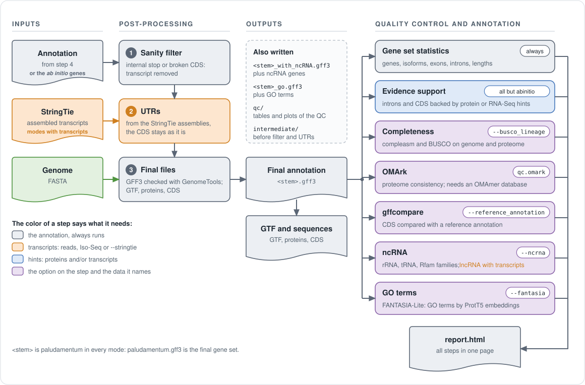

# Paludamentum

<p align="center">
  <br>
  $\color{lightgray}{\tiny\textsf{Logo generated by Gemini}}$
</p>

Authors: Lars Gabriel & Katharina J. Hoff

The paludamentum was the cloak worn by Roman emperors and commanders. This
repository is the cloak around the emperors of the
[Gaius-Augustus](https://github.com/Gaius-Augustus) gene finder family: a
Nextflow pipeline that annotates the protein-coding genes of a eukaryotic
genome. It prepares extrinsic evidence (proteins, RNA-Seq, Iso-Seq), derives
gene candidates from it, and integrates them with the *ab initio*
predictions of the deep learning gene finders
[Tiberius](https://github.com/Gaius-Augustus/Tiberius) and
[Vipsania](https://github.com/Gaius-Augustus/Vipsania) into one gene set.

## Table of contents

- [What the pipeline does](#what-the-pipeline-does)
- [Requirements](#requirements)
- [Installation](#installation)
- [Quick start](#quick-start)
- [Inputs](#inputs)
  - [Existing StringTie assemblies](#existing-stringtie-assemblies)
- [Outputs](#outputs)
- [Gene finders](#gene-finders)
  - [Matching models](#matching-models)
  - [Existing predictions](#existing-predictions)
- [Alternative modes](#alternative-modes)
  - [Iso-Seq and mixed runs](#iso-seq-and-mixed-runs)
  - [Protein-only runs](#protein-only-runs)
  - [Ab initio runs](#ab-initio-runs)
  - [Species without a Tiberius model](#species-without-a-tiberius-model)
  - [Combinations that do not run](#combinations-that-do-not-run)
- [Containers and HPC](#containers-and-hpc)
- [Documentation](#documentation)
- [License](#license)
- [Citation](#citation)
- [References](#references)
- [Funding](#funding)

## What the pipeline does

<p align="center">
  
</p>

Paludamentum annotates the protein-coding genes of a genome from three
sources: the genome itself, proteins of related species, and RNA-Seq reads
of the species. It is designed for a run with all three; this is the default
run of the [Quick start](#quick-start).

1. **Gene prediction on the genome.** The two deep learning gene finders
   Tiberius and Vipsania each predict a gene set from the genome sequence
   alone. Vipsania is fine-tuned on the genome first.
2. **Protein evidence.** The proteins are aligned to the genome. The
   alignments give gene structures and hints on introns and coding regions.
3. **Transcript evidence.** The reads are aligned to the genome and
   assembled into transcripts. Two ORF callers, TD2 and Drusilla, find the
   coding regions of the transcripts, which gives two more gene sets.
4. **Integration.** The four gene sets are compared with the protein
   database and merged into candidate genes per locus. A trained model
   scores every candidate by its support from the gene finders, the proteins
   and the reads, and the best candidates of each locus (the gene and its
   isoforms) form the gene set.
5. **Post-processing and quality control.** Gene models with a broken coding
   sequence are removed, UTRs are added from the transcripts, and the gene
   set is written as GFF3 and GTF with its protein and coding sequences.
   Optional steps assess its completeness, compare it with a reference
   annotation, and add non-coding RNA genes and GO terms. A report sums up
   the run.

The final gene set of every run is `paludamentum.gff3`. Runs with other
inputs (Iso-Seq reads, proteins only, no evidence, a species without a
Tiberius model) are described in [Alternative modes](#alternative-modes).
The steps are described in technical detail in
[docs/combined_flow.md](docs/combined_flow.md) (steps 1 to 4) and
[docs/postprocessing.md](docs/postprocessing.md) (step 5, shown below; the
color of a step says which data it needs, the label which option switches it
on).

<p align="center">
  
</p>

## Requirements

The pipeline runs with Singularity (or Apptainer): the gene finders and all
tools run in container images that the pipeline pulls itself. You do not
install HISAT2, miniprot, StringTie, Tiberius, Vipsania or any other tool.

You need:

- Singularity or Apptainer, on the machine that launches the pipeline and on
  the nodes that run its tasks
- Nextflow 25.04 or newer
- Java 17 or newer (required by Nextflow)
- Python 3.9 or newer
- an NVIDIA GPU on the nodes that run the gene finder step, up to and
  including the Blackwell generation (for example A100 or RTX PRO 6000)

## Installation

```bash
git clone --recursive https://github.com/Gaius-Augustus/Paludamentum
cd Paludamentum
pip install -e .
```

This installs the launcher `paludamentum`. `--recursive` checks out the
submodules `tiberius/`, `vipsania/` and `drusilla/`; in an existing clone run
`git submodule update --init` after `git pull`.

The first run pulls the images into `~/.cache/paludamentum/singularity`,
later runs reuse them. Each gene finder image is about 9.4 GB, the image of
the evidence tools 0.6 GB. The images of BUSCO, FEELnc, OMArk and
FANTASIA-Lite are pulled only when their steps are switched on. On a cluster this directory must be on a file
system that the compute nodes can read; set `NXF_SINGULARITY_CACHEDIR` to
use another directory.

## Quick start

Paludamentum is designed for a genome with protein and RNA-Seq evidence.
Such a run needs four things: the genome, proteins of related species,
RNA-Seq reads, and the gene finder models of the clade.

```bash
paludamentum --nf_config slurm_generic --outdir results \
    --genome genome.fa \
    --proteins proteins.faa \
    --rnaseq_paired "rnaseq/*_{1,2}.fastq.gz" \
    --model_cfg fungi --model Fungi
```

`--model_cfg` is the Tiberius model and `--model` the Vipsania model. If you
give only one of them, the launcher adds the matching model of the other
gene finder, see [Matching models](#matching-models). The final gene set is
`results/paludamentum.gff3`, see [Outputs](#outputs).

The same run from a params file, with command line values overriding the
file:

```bash
paludamentum --params_yaml params.yaml --nf_config slurm_generic
```

```yaml
genome: /abs/path/genome.fa
proteins: /abs/path/proteins.faa
rnaseq_paired: "/abs/path/rnaseq/*_{1,2}.fastq.gz"
outdir: results
tiberius:
  model_cfg: fungi
vipsania:
  model: Fungi
```

Start a params file from [conf/parameters.yaml](conf/parameters.yaml). The
launcher expands `~` and environment variables and resolves relative paths
against the launch directory, not against the params file; it writes the
merged parameters of a run with absolute paths to `<outdir>/params.yaml`.
Paths must not contain spaces. All parameters are documented in
[docs/parameters.md](docs/parameters.md).

Proteins can also come from OrthoDB (`--odb12Partitions`), and RNA-Seq reads
as single-end files, BAM files, SRA accessions or an existing StringTie
assembly, see [Inputs](#inputs).

`--nf_config` takes a path or the name of a config in `conf/`
(`local`, `slurm_generic`, ...); `local` sizes the tasks to the machine it
runs on, `slurm_generic` needs your GPU partition (see
[Containers and HPC](#containers-and-hpc)). Useful options:
`--dry_run` writes the params file and validates inputs and executables
without starting Nextflow, `--resume` continues a previous run, `--work_dir`
sets the Nextflow work directory, `--cleanup` deletes the task directories of
the run from the work directory once it has finished successfully (see
[docs/hpc.md](docs/hpc.md#work-directory)). Arguments after `--` go to Nextflow.
`paludamentum --help` lists everything.

## Inputs

The default run takes `genome`, `proteins` (or `odb12Partitions`) and short reads
(`rnaseq_*`). The other inputs belong to the [alternative modes](#alternative-modes)
or replace steps of the run. Every input can be given on the command line
(`--proteins`, `--rnaseq_bam`, ...) or in the params file.

| Parameter | Content |
| --- | --- |
| `genome` | genome FASTA, optionally gzipped (required) |
| `tiberius.result`, `vipsania.result` (`--result`) | existing prediction of the gene finder, GFF3 or GTF, used instead of running it, see [Existing predictions](#existing-predictions) |
| `proteins` | one protein FASTA or a list; lists are concatenated |
| `odb12Partitions` | OrthoDB v12 partitions to download: `Metazoa`, `Vertebrata`, `Viridiplantae`, `Arthropoda`, `Fungi`, `Alveolata`, `Stramenopiles`, `Amoebozoa`, `Euglenozoa`, `Eukaryota` |
| `rnaseq_paired`, `rnaseq_single` | short read FASTQ files (glob or list) |
| `rnaseq_bam` | aligned short reads, for example from VARUS |
| `rnaseq_stringtie` | StringTie assembly (GTF) of the short reads, one file; instead of the reads, or with the reads it was made from, see [Existing StringTie assemblies](#existing-stringtie-assemblies) |
| `stringtie` | one StringTie assembly (GTF) of all reads of the run, made outside the pipeline, exactly one file; instead of reads, or with the reads it was made from, see [Existing StringTie assemblies](#existing-stringtie-assemblies) |
| `chains` | GTF/GFF3 files of full-length read transcripts (for example the `stringtie -L` assembly of long reads) for `combine_genesets.py`; made automatically in mixed mode, see [Long-read transcripts](docs/parameters.md#long-read-transcripts-chains) |
| `rnaseq_varus`, `isoseq_varus`, `mixed_varus` | [pyVARUS](https://github.com/Gaius-Augustus/pyVARUS) output directories, which bring their StringTie assembly and intron hints but no BAM, so there is no coverage track; see [docs/parameters.md](docs/parameters.md#pyvarus-output-directories) |
| `isoseq` | Iso-Seq FASTQ files |
| `isoseq_bam` | aligned Iso-Seq reads (for example `minimap2 -ax splice:hq -uf`); they skip the alignment |
| `isoseq_stringtie` | StringTie assembly (GTF, `stringtie -L`) of the Iso-Seq reads, one file; instead of the reads, or with the reads it was made from |
| `rnaseq_sra_paired`, `rnaseq_sra_single`, `isoseq_sra` | SRA run accessions, downloaded by the pipeline; an accession whose download fails twice is dropped with an `Error is ignored` note, and `-resume` tries it again |
| `keep_downloads` | copy the reads downloaded from SRA to `sra_downloads/` in `outdir`; default false, they stay in the work directory only |
| `min_alignment_rate` | libraries whose alignment rate (percent mapped) is below this value are dropped; default 80. If all RNA-Seq (or all Iso-Seq) libraries are dropped, the run stops with an error |

### Existing StringTie assemblies

If the transcripts are already assembled, pass the StringTie GTF with
`--stringtie` (`stringtie` in the params file). The pipeline then does not
run StringTie; the assembly is used as it is.

```bash
paludamentum --nf_config local --genome genome.fa \
    --model_cfg eudicotyledons --model Fungi --proteins proteins.faa --stringtie stringtie.gtf
```

```yaml
stringtie: /abs/path/stringtie.gtf
```

The assembly may come from short reads, Iso-Seq or both (`stringtie --mix`),
and it must be an assembly of this genome FASTA (same sequence names). It
combines with `--result`: an existing prediction and an existing assembly
need no GPU, no mapping and no assembly step.

If you have one assembly per read type instead, give the assembly of the
short reads as `--rnaseq_stringtie` and that of the Iso-Seq reads
(`stringtie -L`) as `--isoseq_stringtie`. Each stands for the reads of its
type, so the two together make a mixed run, and either one combines with
reads, BAM files or SRA accessions of the other type, see
[Iso-Seq and mixed runs](#iso-seq-and-mixed-runs).

```bash
paludamentum --nf_config local --genome genome.fa --model_cfg fungi --model Fungi \
    --proteins proteins.faa --rnaseq_stringtie short.gtf --isoseq_stringtie long.gtf
```

Notes:

- `stringtie` takes exactly one assembly of all reads, and
  `rnaseq_stringtie` and `isoseq_stringtie` one assembly each; several files
  are an error, and so is `stringtie` together with one of the other two.
  The GTF must come from `stringtie` on the
  reads (with `cov` and `TPM` attributes), not from `stringtie --merge`
  (which drops them). Drusilla's StringTie pre-filter reads these
  attributes.
- The reads, BAMs and Iso-Seq reads that the assembly was made from may
  come with it. They are mapped and merged into one BAM only; nothing is
  assembled. The BAM gives the coverage track (`bedtools genomecov`) and
  the intron hints (`bam2hints`).
- pyVARUS directories (`rnaseq_varus`, `isoseq_varus`, `mixed_varus`)
  cannot be combined with a given assembly; that is an error.
- A run with only `stringtie` is reported as mode `rnaseq`, whatever reads
  the assembly was made from. Without reads there is no BAM for `bam2hints`
  and `bedtools genomecov`, so the intron hints and the coverage track are
  derived from the assembly itself (`ASSEMBLY_HINTS`, `bin/assembly_hints.py`):
  the introns of its transcripts, with the summed StringTie `cov` of the
  transcripts sharing an intron as multiplicity, and a bedGraph from the
  exon `cov` values (`intermediate/assembly_introns.gff`,
  `intermediate/assembly_cov.bg.gz`; the introns also enter `hintsfile.gff`).

## Outputs

All files are written to `outdir` (default `<genefinder>_results`). The final
gene set is `paludamentum.gff3`, in every mode.

| File | Content |
| --- | --- |
| `paludamentum.gff3` | **the final gene set**: the integrated annotation, sanity filtered, with UTRs in modes with transcripts (in an ab initio run with one gene finder: its prediction, sanity filtered) |
| `paludamentum.gtf` | the final annotation as GTF |
| `paludamentum_proteins.fa` | protein sequences of all transcripts of the final annotation |
| `paludamentum_cds.fa` | coding sequences of the final annotation |
| `paludamentum_with_ncRNA.gff3` | final annotation plus rRNA, tRNA, Rfam and lncRNA genes (`ncrna.run`) |
| `paludamentum_go.gff3`, `paludamentum_with_ncRNA_go.gff3` | the same with GO terms (`fantasia.run`) |
| `report.html` | methods, gene set statistics, completeness, evidence support, sanity filter, UTRs, ncRNA, versions and references of the run |
| `qc/` | sanity filter and UTR reports, gene set statistics and plots, hint support, completeness, OMArk, gffcompare, FANTASIA, software versions, see [docs/postprocessing.md](docs/postprocessing.md#outputs) |
| `ncrna/` | rRNA, tRNA, Rfam and lncRNA annotations (`ncrna.run`) |
| `intermediate/combined.gff3` | output of `combine_genesets.py` before the sanity filter |
| `intermediate/combined.report.tsv` | per-structure report of combine_genesets (tools, tier, decision, features; last column `p_classifier`, the classifier probability of the structure, in classifier mode) |
| `intermediate/tiberius_ab_initio.gff3`, `intermediate/vipsania_ab_initio.gff3` | *ab initio* predictions of each gene finder, before the integration; the files to give to `--result` of a later run |
| `intermediate/drusilla_orfs.gtf` | Drusilla ORFs on the StringTie assembly |
| `intermediate/td2.gff3` | revised TD2 ORFs mapped to the genome |
| `intermediate/rna_cov.bg.gz` | read-depth bedGraph of the merged BAM (`bedtools genomecov -bg -split`, gzipped) |
| `intermediate/paludamentum_sanity_filtered.gff3` | the annotation after the sanity filter, before the UTRs |
| `hintsfile.gff` | protein, RNA-Seq and Iso-Seq hints (concatenated, for gene support) |
| `sra_downloads/` | reads downloaded from SRA, with `keep_downloads: true` only |
| `params.yaml` | the merged parameters of this run, written by the launcher |
| `citations.md` | references of the gene finder and the tools that this run used, see [Citation](#citation) |
| `methods.md` | a methods section for this run: the steps that ran, their main parameters and inline citations of `citations.md`, see [Citation](#citation) |

Nextflow's timeline, trace and report files are written as well.

## Gene finders

The default run and every other run with evidence use **both** gene finders,
Tiberius and Vipsania, each with the model of the clade of the genome.

| Gene finder | Model | Parameters |
| --- | --- | --- |
| Tiberius | `tiberius.model_cfg` (`--model_cfg`), a name in `tiberius/model_cfg` of the submodule (for example `fungi`) or a path | [docs/parameters.md](docs/parameters.md#gene-finder-tiberius) |
| Vipsania | `vipsania.model` (`--model`), a clade name (for example `Fungi`) or a model id | [docs/vipsania.md](docs/vipsania.md) |

Model weights are downloaded once on the submitting host, so the GPU nodes
need no internet; `model_dir` takes weights that you downloaded yourself.
Vipsania is fine-tuned on the target genome by default in runs with evidence
(one GPU task on the whole genome; set `vipsania.finetune: false` to skip).

### Matching models

If a run with evidence gets the model of one gene finder only, the launcher
adds the matching model of the other one and says so in its log, so that
both gene finders run:

| Vipsania model (`--model`) | Tiberius model (`--model_cfg`) |
| --- | --- |
| `Vertebrata` | `vertebrates` (from Tiberius `mammalia_*`: Vipsania `Vertebrata`) |
| `Insecta` | `insecta` |
| `Fungi` | `fungi` |
| `Streptophyta` | `angiosperms` |
| `Chlorophyta` | `chlorophyta` |
| `Stramenopiles` | none added (from Tiberius `diatoms`: Vipsania `Stramenopiles`) |

- A model that you give is never replaced. Mammals use `vertebrates` like
  all other vertebrates. The Tiberius models trained on mammals only can
  still be given, for example `--model_cfg mammalia_softmasking_v2` (needs a
  soft-masked genome); Vipsania `Vertebrata` is added to them.
- Vipsania `Stramenopiles` gets no Tiberius model, because the Tiberius
  model of that clade is a diatom model. For a diatom, give
  `--model_cfg diatoms`.
- The other Vipsania clades have no Tiberius model, see
  [Species without a Tiberius model](#species-without-a-tiberius-model).
- Nothing is added in an ab initio run (one model is one gene finder there),
  next to an existing prediction of the missing gene finder, or with
  `--no_auto_model` (`auto_model: false` in the params file).

### Existing predictions

If the genome is already annotated with Tiberius or Vipsania, give that
file to the pipeline instead of predicting again. The file may be the GFF3
or the GTF that `tiberius.py` or `vipsania annotate` wrote, or the
`intermediate/<tool>_ab_initio.gff3` of an earlier Paludamentum run. It
must belong to the genome FASTA of this run (same sequence names).

```bash
# Reuse a Tiberius prediction; Vipsania still runs
paludamentum --nf_config local --genome genome.fa \
    --model Fungi --proteins proteins.faa --rnaseq_paired "/abs/path/rnaseq/*_{1,2}.fastq.gz" \
    --tiberius_result tiberius.gff3

# Ab initio run with Vipsania, reuse a previous prediction
paludamentum --genefinder vipsania --nf_config local --genome genome.fa --result vipsania.gff
```

In a params file use `result` in the block of the gene finder (one or
both):

```yaml
tiberius:
  result: /abs/path/tiberius.gff3     # Tiberius does not run
vipsania:
  result: /abs/path/vipsania.gff      # Vipsania does not run
```

The pipeline renames the genes and transcripts of each file
(`gene_000001`, `gene_000001.t1`, ...) and reads its `exon`, `CDS` and UTR
features. A run with evidence still needs the other gene finder's model (or
its `result`), and the integration runs on both predictions.

## Alternative modes

The default run is mode `rnaseq`: a genome, proteins and RNA-Seq reads, with
both gene finders. The pipeline also runs with other inputs. The mode is
inferred from the inputs and can be forced with `mode` (`--mode`). Every mode
needs the genome and at least one gene finder model (or an existing
prediction via `result`).

| Mode | Inputs next to the genome | Gene finders |
| --- | --- | --- |
| `rnaseq` (**default run**) | proteins, and short reads (`rnaseq_*`, a BAM, pyVARUS) or a [StringTie assembly](#existing-stringtie-assemblies) | both |
| `isoseq` | proteins and Iso-Seq reads | both |
| `mixed` | proteins, short reads and Iso-Seq reads | both |
| `proteins` | proteins (`proteins` or `odb12Partitions`), no reads | both |
| `abinitio` | none | one, or both combined when both models are given |
| `rnaseq`, `isoseq`, `mixed` for a [species without a Tiberius model](#species-without-a-tiberius-model) | proteins and reads | Vipsania |

Each alternative has its own trained selection model for the integration
step; their files and thresholds are listed in
[docs/combined_flow.md](docs/combined_flow.md#selection-models-of-the-modes).

### Iso-Seq and mixed runs

Iso-Seq reads take the place of the short reads (mode `isoseq`) or come with
them (mode `mixed`). The run is the default run with another read aligner
(minimap2) and one StringTie assembly of all reads. In mode `mixed` the
transcripts of the Iso-Seq reads alone are also used as evidence of
full-length transcripts in the integration.

Each read type can come in any of four forms, and in several at once:

| | FASTQ | SRA accessions | BAM | StringTie assembly |
| --- | --- | --- | --- | --- |
| short reads | `rnaseq_paired`, `rnaseq_single` | `rnaseq_sra_paired`, `rnaseq_sra_single` | `rnaseq_bam` | `rnaseq_stringtie` |
| Iso-Seq reads | `isoseq` | `isoseq_sra` | `isoseq_bam` | `isoseq_stringtie` |

Any input of the first row together with any input of the second row is a
mixed run. What the pipeline does with them depends on whether an assembly
is given:

- **No assembly given** (FASTQ, SRA accessions and BAM files only): both
  read types end up as alignments, and StringTie assembles them together
  (`stringtie --mix`).
- **An assembly given for one or both read types:** that read type is not
  assembled; the other one is assembled from its alignments. The short-read
  and the Iso-Seq assembly are then used side by side as one transcript set.
  The Iso-Seq assembly also serves as the full-length transcripts.
- **Reads next to their assembly** (for example `rnaseq_stringtie` and
  `rnaseq_bam`) are only aligned, for the coverage track and the intron
  hints. A read type that comes as an assembly alone gets its intron hints
  from that assembly.

```bash
# Iso-Seq reads
paludamentum --nf_config local --genome genome.fa --model_cfg fungi --model Fungi \
    --proteins proteins.faa --isoseq isoseq.fastq.gz

# short reads and Iso-Seq reads
paludamentum --nf_config local --genome genome.fa --model_cfg fungi --model Fungi \
    --proteins proteins.faa --rnaseq_paired "rnaseq/*_{1,2}.fastq.gz" --isoseq isoseq.fastq.gz

# a short-read BAM and an Iso-Seq BAM
paludamentum --nf_config local --genome genome.fa --model_cfg fungi --model Fungi \
    --proteins proteins.faa --rnaseq_bam short.bam --isoseq_bam isoseq.bam

# short reads from SRA and an existing Iso-Seq assembly
paludamentum --nf_config local --genome genome.fa --model_cfg fungi --model Fungi \
    --proteins proteins.faa --rnaseq_sra_paired SRR0000001 --isoseq_stringtie isoseq.gtf
```

### Protein-only runs

Mode `proteins`: a genome and proteins, no reads. Both gene finders run, and
the integration selects among their two gene sets with the protein evidence.
There is no transcript assembly, so no ORF callers, no read coverage and no
UTRs. This mode needs a Tiberius and a Vipsania model.

```bash
paludamentum --nf_config local --genome genome.fa --model_cfg fungi --model Fungi --proteins proteins.faa
```

### Ab initio runs

Mode `abinitio`: a genome and no evidence. With one model that gene finder
runs alone and its prediction is the gene set. With both models both gene
finders run, and the integration selects among the two predictions without
any evidence.

```bash
# Tiberius alone, parallelized over GPUs by Nextflow
paludamentum --nf_config slurm_generic --genome genome.fa --model_cfg angiosperms

# Vipsania alone
paludamentum --nf_config local --genome genome.fa --model Fungi

# both gene finders, combined without evidence
paludamentum --nf_config local --genome genome.fa --model_cfg fungi --model Fungi
```

In a params file with blocks for both gene finders, `genefinder` or
`run: true` in one block names the gene finder of a run with one model:

```yaml
genome: /abs/path/genome.fa
tiberius:
  run: true
  model_cfg: angiosperms
```

### Species without a Tiberius model

Vipsania has models for clades that Tiberius has none for (Nematoda,
Arthropoda beyond insects, Spiralia, Cnidaria, Echinodermata, Porifera,
Tunicata, Alveolata, Amoebozoa, Discoba, Rhodophyta, and a fallback model).
For such a species give `vipsania.model` only. A run with proteins and reads
then uses Vipsania as its only *ab initio* gene finder, next to the two ORF
callers on the transcripts.

```bash
paludamentum --nf_config local --genome genome.fa --model Nematoda --proteins proteins.faa --rnaseq_bam rnaseq.bam
```

This flow needs transcript evidence: mode `proteins` does not run without a
Tiberius model.

### Combinations that do not run

The launcher (and `main.nf`) stops these before anything runs, with a
message that names the supported modes:

- reads or a StringTie assembly without proteins,
- mode `proteins` without a Tiberius model,
- a forced mode whose inputs are missing,
- a run without a genome or without any gene finder model.

## Containers and HPC

The images are pinned in [conf/base.config](conf/base.config) and listed in
[docs/containers.md](docs/containers.md).

`--nf_config` takes a path or the name of a config in `conf/`:
`local` runs everything on one machine, `slurm_generic` is a starting point
for SLURM. For your own cluster, copy
[conf/user_hpc_template.config](conf/user_hpc_template.config) and set your
queues, GPU options and scratch paths, see [docs/hpc.md](docs/hpc.md).
Downloads (SRA reads, OrthoDB partitions, model weights, BUSCO lineages,
Rfam, the NCBI taxonomy for OMArk) run on the submitting host, which needs
internet access.

Running without containers, and other setups for experts, are described in
[docs/advanced_setup.md](docs/advanced_setup.md).

## Documentation

| Page | Content |
| --- | --- |
| [docs/parameters.md](docs/parameters.md) | all parameters: inputs, gene finder blocks, Drusilla block, combine_genesets, mode |
| [docs/vipsania.md](docs/vipsania.md) | Vipsania as gene finder: models, finetuning, offline nodes |
| [docs/combined_flow.md](docs/combined_flow.md) | the evidence and integration steps in technical detail: tools, options, `combine_genesets.py`, selection models, clade table |
| [docs/drusilla_flow.md](docs/drusilla_flow.md) | Drusilla as one of the two ORF callers: StringTie pre-filter, parameters |
| [docs/postprocessing.md](docs/postprocessing.md) | post-processing and quality control: sanity filter, UTRs, GFF3 contract, completeness, ncRNA, GO terms, report |
| [docs/containers.md](docs/containers.md) | container images and how they are pinned |
| [docs/hpc.md](docs/hpc.md) | Nextflow config for your cluster, process labels |
| [docs/advanced_setup.md](docs/advanced_setup.md) | for experts: running without containers, location of the checkout |
| [docs/development.md](docs/development.md) | submodules and status, repository layout, notes for maintainers, testing, roadmap |

## License

Artistic License 1.0, see [LICENSE](LICENSE), with three exceptions, each
marked in the header of the file:

- Scripts in `bin/` copied from Tiberius stay under its MIT License, see
  [LICENSE-Tiberius](LICENSE-Tiberius).
- Scripts in `bin/` copied or ported from BRAKER4 stay under its MIT License,
  see [LICENSE-BRAKER4](LICENSE-BRAKER4).
- `bin/fantasia_generate_embeddings.py` is derived from
  [FANTASIA-Lite](https://github.com/CBBIO/FANTASIA-Lite) and is under the GNU
  Affero General Public License v3.0, see
  [LICENSE-FANTASIA-Lite](LICENSE-FANTASIA-Lite). It is only used when
  `--fantasia` is on, where it is bound into the FANTASIA-Lite container.

## Citation

Every run writes `citations.md` to `outdir`. It lists the references of the
gene finder and of the tools that this run used, selected from its inputs and
parameters. Please cite them in a publication that uses the results.

`methods.md` next to it describes, in the style of a Methods section and in
the order of execution, what the run did (mode, gene finder and model,
evidence processing, high-confidence genes, post-processing, quality control,
ncRNA and GO terms as switched on), with inline citations of the references
in `citations.md`. `report.html` shows it as well. Check and adapt the text
before you use it in a publication.

## References

**Pipeline and gene finders**

- **Paludamentum** (the pipeline). Gabriel L, Hoff KJ. Paludamentum: evidence integration pipeline for the Gaius-Augustus gene finders. 2026. <https://github.com/Gaius-Augustus/Paludamentum>
- **Nextflow** (workflow engine). Di Tommaso P, Chatzou M, Floden EW, Barja PP, Palumbo E, Notredame C. Nextflow enables reproducible computational workflows. Nature Biotechnology. 2017;35(4):316-319. [doi:10.1038/nbt.3820](https://doi.org/10.1038/nbt.3820)
- **Tiberius** (gene prediction). Gabriel L, Becker F, Hoff KJ, Stanke M. Tiberius: end-to-end deep learning with an HMM for gene prediction. Bioinformatics. 2024;40(12):btae685. [doi:10.1093/bioinformatics/btae685](https://doi.org/10.1093/bioinformatics/btae685)
- **Tiberius** (models of the non-mammalian clades). Gabriel L, Brůna T, Kaur A, Krishnan A, Ortmann F, Salamov A, Talbot S, Becker F, Krieg R, Wheat CW, Grigoriev IV, Stanke M, Hoff KJ. Accurate *ab initio* gene prediction in eukaryotes with Tiberius in multiple clades. bioRxiv. 2026. [doi:10.64898/2026.04.24.720536](https://doi.org/10.64898/2026.04.24.720536)
- **Vipsania** (gene prediction). Krieg R, Becker F, Saenko S, Diehl J, Stanke M. Vipsania: Unsupervised Deep Gene Finding. bioRxiv. 2026. [doi:10.64898/2026.08.26.747235](https://doi.org/10.64898/2026.08.26.747235)

**Protein evidence**

- **OrthoDB v12** (protein database). Tegenfeldt F, Kuznetsov D, Manni M, Berkeley M, Zdobnov EM, Kriventseva EV. OrthoDB and BUSCO update: annotation of orthologs with wider sampling of genomes. Nucleic Acids Research. 2025;53(D1):D516-D522. [doi:10.1093/nar/gkae987](https://doi.org/10.1093/nar/gkae987)
- **miniprot** (protein to genome alignment). Li H. Protein-to-genome alignment with miniprot. Bioinformatics. 2023;39(1):btad014. [doi:10.1093/bioinformatics/btad014](https://doi.org/10.1093/bioinformatics/btad014)
- **miniprot-boundary-scorer and miniprothint** (scoring of the protein alignments, protein hints). Brůna T, Li H, Guhlin J, Honsel D, Herbold S, Stanke M, Nenasheva N, Ebel M, Gabriel L, Hoff KJ. Galba: genome annotation with miniprot and AUGUSTUS. BMC Bioinformatics. 2023;24(1):327. [doi:10.1186/s12859-023-05449-z](https://doi.org/10.1186/s12859-023-05449-z)
- **DIAMOND** (protein homology on the four combine_genesets gene sets, selection of source species in large protein databases, TD2 revise). Buchfink B, Reuter K, Drost HG. Sensitive protein alignments at tree-of-life scale using DIAMOND. Nature Methods. 2021;18(4):366-368. [doi:10.1038/s41592-021-01101-x](https://doi.org/10.1038/s41592-021-01101-x)
- **bedtools** (RNA-Seq read-depth bedGraph for combine_genesets). Quinlan AR, Hall IM. BEDTools: a flexible suite of utilities for comparing genomic features. Bioinformatics. 2010;26(6):841-842. [doi:10.1093/bioinformatics/btq033](https://doi.org/10.1093/bioinformatics/btq033)

**Transcript evidence**

- **HISAT2** (alignment of short reads). Kim D, Paggi JM, Park C, Bennett C, Salzberg SL. Graph-based genome alignment and genotyping with HISAT2 and HISAT-genotype. Nature Biotechnology. 2019;37(8):907-915. [doi:10.1038/s41587-019-0201-4](https://doi.org/10.1038/s41587-019-0201-4)
- **minimap2** (alignment of Iso-Seq reads). Li H. Minimap2: pairwise alignment for nucleotide sequences. Bioinformatics. 2018;34(18):3094-3100. [doi:10.1093/bioinformatics/bty191](https://doi.org/10.1093/bioinformatics/bty191)
- **SAMtools** (processing of alignments). Danecek P, Bonfield JK, Liddle J, Marshall J, Ohan V, Pollard MO, Whitwham A, Keane T, McCarthy SA, Davies RM, Li H. Twelve years of SAMtools and BCFtools. GigaScience. 2021;10(2):giab008. [doi:10.1093/gigascience/giab008](https://doi.org/10.1093/gigascience/giab008)
- **AUGUSTUS (bam2hints)** (intron hints from read alignments). Stanke M, Diekhans M, Baertsch R, Haussler D. Using native and syntenically mapped cDNA alignments to improve *de novo* gene finding. Bioinformatics. 2008;24(5):637-644. [doi:10.1093/bioinformatics/btn013](https://doi.org/10.1093/bioinformatics/btn013)
- **VARUS** (sampled and aligned reads of the pyVARUS input). Stanke M, Bruhn W, Becker F, Hoff KJ. VARUS: sampling complementary RNA reads from the sequence read archive. BMC Bioinformatics. 2019;20(1):558. [doi:10.1186/s12859-019-3182-x](https://doi.org/10.1186/s12859-019-3182-x)
- **StringTie** (transcript assembly). Kovaka S, Zimin AV, Pertea GM, Razaghi R, Salzberg SL, Pertea M. Transcriptome assembly from long-read RNA-seq alignments with StringTie2. Genome Biology. 2019;20(1):278. [doi:10.1186/s13059-019-1910-1](https://doi.org/10.1186/s13059-019-1910-1)
- **GffRead and GffCompare** (format conversion, protein sequences, comparison with a reference annotation). Pertea G, Pertea M. GFF Utilities: GffRead and GffCompare. F1000Research. 2020;9:304. [doi:10.12688/f1000research.23297.2](https://doi.org/10.12688/f1000research.23297.2)

**High-confidence genes**

- **TransDecoder (cdna_alignment_orf_to_genome_orf.pl)** (ORF-to-genome mapping of the revised TD2 ORFs). Haas BJ, Papanicolaou A, Yassour M, et al. De novo transcript sequence reconstruction from RNA-seq using the Trinity platform for reference generation and analysis. Nature Protocols. 2013;8(8):1494-1512. [doi:10.1038/nprot.2013.084](https://doi.org/10.1038/nprot.2013.084)
- **TD2** (one of the two ORF callers of step 4). Mao A, Ji HJ, Haas BJ, Salzberg SL, Sommer MJ. TD2: finding protein coding regions in transcripts. bioRxiv. 2025. [doi:10.1101/2025.04.13.648579](https://doi.org/10.1101/2025.04.13.648579)
- **PSAURON** (ORF scores of TD2). Sommer MJ, Zimin AV, Salzberg SL. PSAURON: a tool for assessing protein annotation across a broad range of species. NAR Genomics and Bioinformatics. 2025;7(1):lqae189. [doi:10.1093/nargab/lqae189](https://doi.org/10.1093/nargab/lqae189)
- **Drusilla** (one of the two ORF callers of step 4). Gabriel L, Hoff KJ. Annotating Eukaryotic Genomes by Combining Deep Learning with extrinsic evidence. Poster, German Conference on Bioinformatics (GCB). 2026. [doi:10.13140/RG.2.2.24444.91521](https://doi.org/10.13140/RG.2.2.24444.91521)

**Post-processing and quality control**

- **GenomeTools** (validation of the published GFF3 files). Gremme G, Steinbiss S, Kurtz S. GenomeTools: a comprehensive software library for efficient processing of structured genome annotations. IEEE/ACM Transactions on Computational Biology and Bioinformatics. 2013;10(3):645-656. [doi:10.1109/TCBB.2013.68](https://doi.org/10.1109/TCBB.2013.68)
- **BUSCO** (completeness of genome and proteome). Manni M, Berkeley MR, Seppey M, Simão FA, Zdobnov EM. BUSCO Update: novel and streamlined workflows along with broader and deeper phylogenetic coverage for scoring of eukaryotic, prokaryotic, and viral genomes. Molecular Biology and Evolution. 2021;38(10):4647-4654. [doi:10.1093/molbev/msab199](https://doi.org/10.1093/molbev/msab199)
- **compleasm** (completeness of genome and proteome). Huang N, Li H. compleasm: a faster and more accurate reimplementation of BUSCO. Bioinformatics. 2023;39(10):btad595. [doi:10.1093/bioinformatics/btad595](https://doi.org/10.1093/bioinformatics/btad595)
- **OMArk** (consistency and completeness of the proteome). Nevers Y, Warwick Vesztrocy A, Rossier V, Train CM, Altenhoff A, Dessimoz C, Glover NM. Quality assessment of gene repertoire annotations with OMArk. Nature Biotechnology. 2025;43(1):124-133. [doi:10.1038/s41587-024-02147-w](https://doi.org/10.1038/s41587-024-02147-w)
- **OMAmer** (protein families of the proteome for OMArk). Rossier V, Warwick Vesztrocy A, Robinson-Rechavi M, Dessimoz C. OMAmer: tree-driven and alignment-free protein assignment to subfamilies outperforms closest sequence approaches. Bioinformatics. 2021;37(18):2866-2873. [doi:10.1093/bioinformatics/btab219](https://doi.org/10.1093/bioinformatics/btab219)
- **pybarrnap** (rRNA genes). Shimoyama Y. pybarrnap: Python implementation of barrnap. 2024. <https://github.com/moshi4/pybarrnap>
- **barrnap** (method and rRNA models that pybarrnap re-implements). Seemann T. barrnap 0.9: BAsic Rapid Ribosomal RNA Predictor. 2018. <https://github.com/tseemann/barrnap>
- **tRNAscan-SE** (tRNA genes). Chan PP, Lin BY, Mak AJ, Lowe TM. tRNAscan-SE 2.0: improved detection and functional classification of transfer RNA genes. Nucleic Acids Research. 2021;49(16):9077-9096. [doi:10.1093/nar/gkab688](https://doi.org/10.1093/nar/gkab688)
- **Infernal** (ncRNA genes of the Rfam families). Nawrocki EP, Eddy SR. Infernal 1.1: 100-fold faster RNA homology searches. Bioinformatics. 2013;29(22):2933-2935. [doi:10.1093/bioinformatics/btt509](https://doi.org/10.1093/bioinformatics/btt509)
- **Rfam** (RNA families database (release 15.1)). Ontiveros-Palacios N, Cooke E, Nawrocki EP, Triebel S, Marz M, Rivas E, Griffiths-Jones S, Petrov AI, Bateman A, Sweeney B. Rfam 15: RNA families database in 2025. Nucleic Acids Research. 2025;53(D1):D258-D267. [doi:10.1093/nar/gkae1023](https://doi.org/10.1093/nar/gkae1023)
- **FEELnc** (lncRNA genes). Wucher V, Legeai F, Hédan B, et al. FEELnc: a tool for long non-coding RNA annotation and its application to the dog transcriptome. Nucleic Acids Research. 2017;45(8):e57. [doi:10.1093/nar/gkw1306](https://doi.org/10.1093/nar/gkw1306)
- **FANTASIA** (GO terms from protein language model embeddings). Martínez-Redondo GI, Perez-Canales FM, Carbonetto B, Fernández JM, Barrios-Núñez I, Vázquez-Valls M, Cases I, Rojas AM, Fernández R. FANTASIA leverages language models to decode the functional dark proteome across the animal tree of life. Communications Biology. 2025;8(1):1227. [doi:10.1038/s42003-025-08651-2](https://doi.org/10.1038/s42003-025-08651-2)
- **FANTASIA suite (FANTASIA-Lite)** (GO term annotation software). Pérez-Canales FM, Domínguez-Rodríguez À, Carbonetto B, Fernández R, Cases I, Rojas AM. FANTASIA suite: a reproducible and configurable framework for embedding-based functional annotation of proteins. NAR Genomics and Bioinformatics. 2026;8(3):lqag106. [doi:10.1093/nargab/lqag106](https://doi.org/10.1093/nargab/lqag106)
- **ProtT5** (protein language model of FANTASIA). Elnaggar A, Heinzinger M, Dallago C, Rehawi G, Wang Y, Jones L, Gibbs T, Feher T, Angerer C, Steinegger M, Bhowmik D, Rost B. ProtTrans: Toward Understanding the Language of Life Through Self-Supervised Learning. IEEE Transactions on Pattern Analysis and Machine Intelligence. 2022;44(10):7112-7127. [doi:10.1109/TPAMI.2021.3095381](https://doi.org/10.1109/TPAMI.2021.3095381)

## Funding

Funded by the Deutsche Forschungsgemeinschaft (DFG, German Research
Foundation), project number 552910312: "AI-GUSTUS: Eine cloud-native Pipeline
für genaue Genom-Annotation" (AI-GUSTUS: a cloud-native pipeline for accurate
genome annotation).
