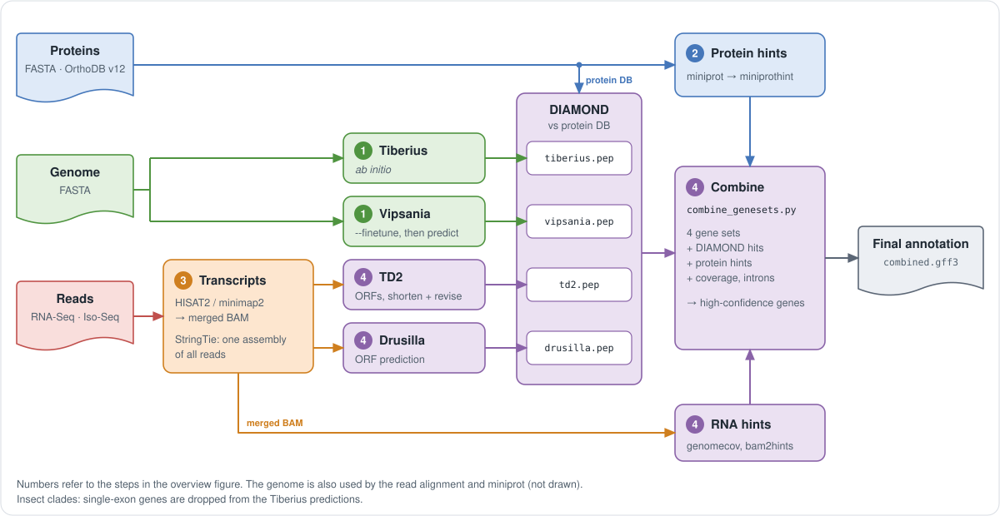

# Evidence and integration steps (combined HC flow)

This page describes steps 1 to 4 of the [overview](../README.md#what-the-pipeline-does)
in technical detail: the tools and options of each step, the integration with
`bin/combine_genesets.py`, the selection models of the modes and the clade
table. Step 5 is described in [postprocessing.md](postprocessing.md).

  

## Steps of a run with evidence

1. ***Ab initio* predictions.** Both gene finders run in parallel: Tiberius
   on genome chunks, and Vipsania with `--finetune` on the whole genome
   (default on; one GPU task). An existing Tiberius or Vipsania prediction
   (`--result`) is used instead of running that gene finder, see
   [Existing predictions](../README.md#existing-predictions).
2. **Protein evidence.** Proteins (FASTA files and/or OrthoDB v12
   partitions) are aligned with miniprot, scored with
   miniprot-boundary-scorer, and converted to hints with miniprothint. For
   very large protein databases the Tiberius *ab initio* proteins are used to
   select the most relevant source species first (DIAMOND).
3. **Transcript evidence.** Short reads are aligned with HISAT2, Iso-Seq reads
   with minimap2. Libraries with a low alignment rate are dropped. The
   library strandedness of every short-read BAM is recovered before the
   assembly (`strand_fix`, on by default). One StringTie assembly of all
   reads is made (`stringtie`, `stringtie -L` or `stringtie --mix`). An
   existing StringTie assembly (`--stringtie`) is used instead, see
   [Existing StringTie assemblies](../README.md#existing-stringtie-assemblies).
4. **Combined high-confidence genes.** Two ORF callers run on the StringTie
   assembly: TD2 (with `TD2.LongOrfs`, `TD2.Predict`, then two auxiliary
   DIAMOND passes and `revise_pep.py` for the partial-ORF rescue; the
   revised ORFs are mapped back to the genome with
   `cdna_alignment_orf_to_genome_orf.pl`) and Drusilla (StringTie pre-filter
   and `drusilla annotate` with the Drusilla model of all clades, see
   [drusilla_flow.md](drusilla_flow.md)). DIAMOND runs on the proteins of
   all four gene sets (Tiberius, Vipsania, revised TD2, Drusilla).
   `bedtools genomecov -bg -split` writes a read-depth bedGraph, and
   `bam2hints --intronsonly` plus `filterIntronsFindStrand.pl` writes intron
   hints. `bin/combine_genesets.py` integrates the four gene sets, the four
   DIAMOND tables, miniprot alignments and miniprothint hints, the bedGraph
   and the introns into one GFF3 (`intermediate/combined.gff3`), which the
   post-processing turns into `paludamentum.gff3`.

The same flow runs for every clade. The clade of the gene finder model only
decides two switches of `combine_genesets.py`, see
[Clade table](#clade-table).

## Integration step by step

Steps of the combined HC flow (the default run; the other modes leave out the inputs they do not have):

1. One StringTie assembly of all reads (short, Iso-Seq with `-L`, or both
   with `--mix`). A `--stringtie` assembly made outside the pipeline is
   used as it is; it must carry the `cov` and `TPM` attributes. The one
   assembly is not passed through `stringtie --merge` (only the GFF3 that
   TD2 needs is written from it); several assemblies would be merged.
2. **Drusilla** filters the StringTie assembly (length, coverage, TPM) and
   predicts the ORFs of the kept transcripts with the one Drusilla model of
   all clades (`drusilla_model`; set `drusilla.model` to use `vertebrates`
   or `insects`). Isoforms whose CDS is a subsequence of another
   one are collapsed.
3. **TD2** predicts ORFs on the full StringTie assembly. ORFs are then
   shortened to their first methionine where incomplete,
   `CDS_CLASSIFY_AND_REVISE` runs two auxiliary DIAMOND passes to decide
   whether to keep the original or the trimmed start, and the revised ORFs
   are mapped back to the genome with
   `cdna_alignment_orf_to_genome_orf.pl`.
4. For each of the four gene sets (Tiberius, Vipsania, revised TD2,
   Drusilla), `PROTEIN_FROM_GFF` extracts proteins with gffread (`-S`:
   internal stops are written as `*`, which DIAMOND accepts).
   `bin/check_internal_stops.py` writes a `WARN` line to the run log when
   more than 5% of a gene set's proteins have an internal stop. The usual
   cause is wrong CDS phases in a reused `<tool>.result`, which
   `bin/fix_cds_phases.py` repairs; the run continues.
   `DIAMOND_BLASTP_FULL` searches the proteins against the protein database with
   the 14-column outfmt (`qseqid sseqid pident length mismatch gapopen
   qstart qend sstart send evalue bitscore qlen slen`). It reads GFF3 and
   GTF (the Drusilla ORFs) and keeps at most 10 isoforms per gene; an
   isoform beyond the cap has no DIAMOND hit.
5. `bedtools genomecov -ibam BAM -bg -split | gzip > rna_cov.bg.gz` writes
   the read-depth bedGraph, and `bam2hints --intronsonly` plus
   `filterIntronsFindStrand.pl` writes the intron hints. In mixed mode both
   intron hint files (short reads and Iso-Seq) go to `combine_genesets.py`,
   which sums them per intron. pyVARUS directories and a `--stringtie`
   assembly without reads have no BAM: `combine_genesets.py` then runs
   without `--coverage` (pyVARUS hints are still used). Transcripts of
   full-length reads (`chains`, or in mixed mode the `stringtie -L` assembly
   of the Iso-Seq reads alone) go to `combine_genesets.py --chains`; the ORF
   callers do not see them.
6. `combine_genesets.py` integrates all of the above. By default
   (`combine.classifier = "${projectDir}/conf/combiner_classifier_v1.json"`)
   it runs in classifier mode: the candidate pool is built as with
   `--keep-all` (every unique CDS structure, all tier rules off), and a
   gradient-boosted tree model (400 trees of depth 3, exported to JSON,
   evaluated with numpy; scikit-learn is not needed at run time) gives each
   candidate P(structure = reference CDS) from 47 features of the report
   (tools, structure, locus context, RNA-Seq intron and coverage evidence,
   DIAMOND and miniprot protein evidence; no clade input). Per locus the
   best candidate is the primary if its P reaches the locus threshold
   (0.25); further candidates are isoforms if P reaches 0.30. The `reason`
   column of the report is `primary`, `isoform_classifier`,
   `isoform_rejected`, `locus_below_min` or `dropped_lone_single_exon`, and
   the last column is `p_classifier`. With `combine.classifier = false` the
   tier rules apply (merging, clustering, tiering with the four tool sets,
   RNA / protein / DIAMOND adjustments; `combine.min_locus` is the minimum
   tier of a locus); see [drusilla_flow.md](drusilla_flow.md) and
   `combine_genesets.py --help`. The full-length transcript evidence
   (`--chains`, mixed and Iso-Seq runs) is not a model feature (no training
   species has long reads); in classifier mode it raises the log-odds of a
   structure whose CDS chain lies in one full-length transcript by 1.5
   (`--chain-logit-full`).

## Selection models of the modes

All selection models are gradient-boosted trees of the same recipe, trained
on the keep-all candidate pools of the same 15 species (4 insects, 7 fungi,
2 vertebrates, 2 plants) with gffcompare labels. They differ in the features
that the inputs of the mode provide. The models are clade-agnostic.

| Run | Parameter | File | Features | Thresholds (locus / isoform) |
| --- | --- | --- | --- | --- |
| default run and modes `isoseq`, `mixed` | `combine.classifier` | `conf/combiner_classifier_v1.json` | 47: tools, structure, locus context, RNA-Seq intron and coverage evidence, DIAMOND and miniprot protein evidence | 0.25 / 0.30 (locus 0.30 for a clade outside the clade table) |
| mode `proteins` | `combine.classifier_proteins` | `conf/combiner_classifier_protonly_v1.json` | 41: no RNA-Seq features | 0.20 / 0.30 (locus 0.30 for a clade outside the clade table) |
| evidence mode without a Tiberius model | `combine.classifier_vipsania` | `conf/combiner_classifier_vipsania_v1.json` | as the default, without the Tiberius gene set | 0.225 / 0.30 |
| mode `abinitio` with both models | `combine.classifier_abinitio` | `conf/combiner_classifier_abinitio_v1.json` | 18: tools, structure and locus context only | 0.30 / 0.25 |

- **Mode `proteins`.** `combine_genesets.py` receives the Tiberius and
  Vipsania gene sets, their two DIAMOND tables and the miniprot and
  miniprothint evidence: no StringTie assembly, no ORF callers, no coverage
  track and no intron hints. `combine.classifier_proteins = false` selects
  with the tier rules, whose RNA rules stay off. `combine.t_locus` sets
  another locus threshold.
- **Evidence mode without a Tiberius model.** Vipsania (fine-tuned on the
  genome by default) is the only *ab initio* gene set, its proteins select
  the species of a large protein database, and `combine_genesets.py`
  integrates three gene sets (Vipsania, revised TD2, Drusilla). The RNA-Seq
  multiplicity is normalised by the median over the structures that all
  tools of the run predicted (three here, four with Tiberius).
- **Mode `abinitio` with both models.** `combine_genesets.py` integrates the
  two predictions without any evidence: no protein database, no DIAMOND, no
  miniprot, no transcripts.

## Clade table

`conf/hc_genes.yaml` (`hc_table`) lists the known clades of the gene finder
models. It does not select a workflow: the flow is the same for every clade.
It decides two things.

- `classifier_clade` names the training clade of the selection model that
  covers the clade: `Vertebrata` and `Mammalia` use `vertebrates`,
  `Mesangiospermae` (the Tiberius angiosperms model) uses `embryophyta`,
  `Fungi` uses `fungi`, `Insecta` and `Lepidoptera` use `insects`. A clade
  with neither `classifier_clade` nor `standard_thresholds`, or one not in the
  table, is new to the model and the pipeline passes `--unknown-clade`, which
  raises the locus threshold of the default model to 0.30.
- `standard_thresholds: true` marks a clade the classifier has not seen but
  that gets the thresholds of the training clades (0.25 with the evidence-mode
  model) instead of `--unknown-clade`. The Tiberius chlorophyta and diatoms
  models (Chlorophyta, Bacillariophyta) use it: on two chlorophytes and two
  diatoms it was as accurate as 0.30 or slightly better. A Vipsania-only
  diatom run (Vipsania model Stramenopiles, no Tiberius model) still counts
  as an unknown clade, since Stramenopiles covers more than diatoms.
- For `Insecta` and `Lepidoptera` the pipeline passes
  `--drop-lone-single-exon tiberius` to `combine_genesets.py`, because
  Tiberius overpredicts single-exon genes in insects. In classifier mode
  lone single-exon Tiberius structures without a miniprot match are never
  selected (`dropped_lone_single_exon`); in rules mode they are demoted.

A new clade is added to the table with its `classifier_clade` (or with
`standard_thresholds: true`). The Drusilla
model does not depend on the clade (`drusilla.model`, default
`drusilla_model`).
