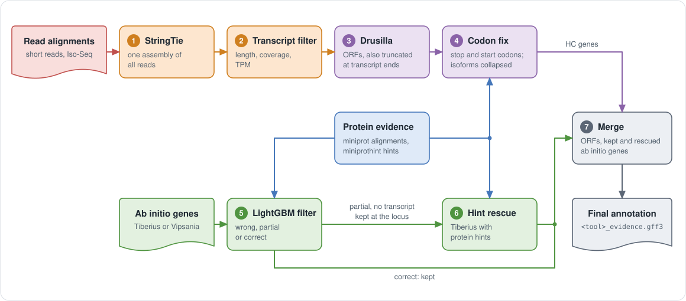
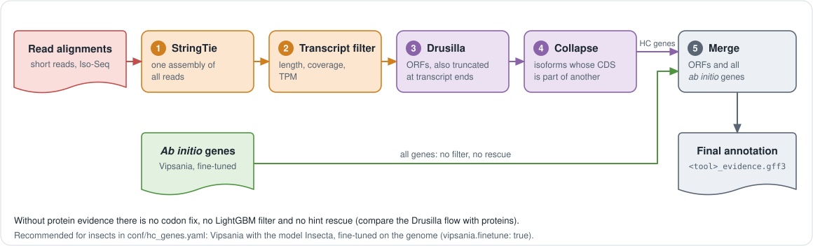

# Drusilla flow

For vertebrate, mammal and insect gene finder models, Paludamentum replaces
the TransDecoder high-confidence genes with Drusilla ORFs. With protein
evidence, the *ab initio* predictions of vertebrates and mammals are also
filtered; insects need no proteins (see [Without proteins](#without-proteins)).
The flow with proteins is derived from the one behind the Tiberius evidence
results on the GCB 2026 poster
([doi:10.13140/RG.2.2.24444.91521](https://doi.org/10.13140/RG.2.2.24444.91521)),
which used an earlier Drusilla model and had no stop/start codon fix, no hint
rescue and no merge of overlapping genes. With this flow, the gene-level F1
is 80.70 on *Takifugu rubripes* with the Tiberius `vertebrates` model
(Paludamentum 0.5.0, gffcompare 0.12.10, prepared as `GFFCOMPARE` of the
pipeline does) and 79.71 on *Bos taurus* with `mammalia_softmasking_v2`
(Paludamentum 0.4.0).
It runs when all of these hold:

- the run has transcripts (mode `rnaseq`, `isoseq` or `mixed`),
- the clade of the gene finder model has `hc: drusilla` in
  [conf/hc_genes.yaml](../conf/hc_genes.yaml): today `Vertebrata`, `Mammalia`
  and `Insecta`, i.e. Tiberius models with that `target_species`
  (`vertebrates`, `mammalia*`, `insecta*`, and `lepidoptera`, whose
  `Lepidoptera` the table lists as well), and Vipsania `Vertebrata`
  (`etb1go6q`) and `Insecta` (`58hsuobw`); `drusilla.run: true` forces the
  flow for other models (with the models of the table's `drusilla_forced`
  clade, `Vertebrata`, unless the clade has its own), `false` switches it off,
- a Drusilla model is known for the clade: `drusilla_model` in
  `conf/hc_genes.yaml` (`vertebrates`, `insects`), or `drusilla.model`.

The LightGBM filter and the hint rescue (steps 5 and 6) also need protein
evidence and a LightGBM model of the clade (`lgb_model`; `Vertebrata` and
`Mammalia` have one, `Insecta` has none). The stop and start codon fix (step
4) needs protein evidence. Without them, the ORFs are merged with all *ab
initio* predictions.

Every other clade gets the TransDecoder flow with TD2 as ORF finder
(`orf_finder` in `conf/hc_genes.yaml`, or `transdecoder: td1` for
TransDecoder 5.7.1), which needs protein evidence. When a Drusilla model is
released for another clade, add the clade to `conf/hc_genes.yaml` with
`hc: drusilla` and `drusilla_model`, and `lgb_model` and `lgb_model_sha256`
if there is a LightGBM model for it; `hc_table` points a run at another
table.

<p align="center">
  
</p>

Steps of the flow with proteins (numbered as in the figure):

1. One StringTie assembly of all reads (short reads, Iso-Seq with `-L`, or
   both with `--mix`). An assembly made outside the pipeline can be given
   with `stringtie`; it must be that one assembly, with the `cov` and `TPM`
   attributes of StringTie (not the output of `stringtie --merge`).
2. Transcripts are kept if length >= 300, coverage >= 3 and TPM >= 1 (TPM >= 0.5
   for transcripts of 3000 nt or longer).
3. `drusilla annotate` predicts the ORFs of the kept transcripts, including
   ORFs truncated at the 3' or 5' end of a transcript. The released model
   (`vertebrates`: weights of the training run `cnn_lstm_vertebrates_run009`)
   is downloaded once on the submitting host and checked against the
   `weights_sha256` of its manifest in `drusilla/model_cfg/`, so the GPU nodes
   need no internet for it. With `cache_dir`, Drusilla takes the model from
   that cache instead (`drusilla models download vertebrates` with
   `DRUSILLA_CACHE_DIR` set to it fills it once).
4. With proteins. Stop codon fix: ORFs with an early stop and truncated ORFs are extended to
   a stop codon supported by a miniprot alignment. Start codon fix: ORFs
   without an upstream in-frame stop are extended to a start codon hint of
   miniprothint. Isoforms whose CDS is a subsequence of another one are then
   collapsed.
5. With proteins and a LightGBM model. A LightGBM model classifies each *ab initio* transcript as wrong, partial or
   correct, from miniprot alignment and miniprothint hint features. Transcripts
   with P(partial) + P(correct) >= 0.5 whose most likely class is `correct`
   are kept. The model (`drusilla_lgb_3class_v1`, a LightGBM text model) is
   downloaded by Nextflow at the start of the run and checked against its
   sha256, so the compute nodes need no internet for it.
6. With the LightGBM filter. Hint rescue: loci of `partial` transcripts without a kept transcript are
   predicted again by Tiberius with the hints of the best protein chain of the
   locus; loci without a protein chain are predicted *ab initio*, without hints.
   With `rescue_orf_filter: true`, loci where a Drusilla ORF already has all
   introns of the chain are skipped; the filter is off by default, and the
   F1 values above were measured without it. This needs a Tiberius with
   `--hints` (branch `hint_integration`, with bricks2marble from its branch
   `intron_hints`). The step therefore runs in its own image (see
   [Containers](containers.md)). `rescue_tiberius`
   is another `tiberius.py` to use instead. If the Tiberius has no `--hints`,
   the step is skipped with a warning in the Nextflow log, and no GPU task is
   started. The Tiberius of the hint rescue image writes the CDS phases of
   minus-strand transcripts counted from the wrong end; `bin/fix_cds_phases.py`
   recomputes them from the start codon (the structures stay as predicted), as
   otherwise the sanity filter of the post-processing reads them as
   5'-partial and removes them.
7. The kept and rescued *ab initio* transcripts and the Drusilla ORFs are merged
   into `<tool>_evidence.gff3`.

```yaml
drusilla:
  run: auto              # auto: per conf/hc_genes.yaml; true: always; false: never
  model: null            # released Drusilla model; null = drusilla_model of the clade in conf/hc_genes.yaml
  weights: null          # a local .weights.h5 instead (needs config)
  config: null
  cache_dir: null        # model cache (DRUSILLA_CACHE_DIR); null = downloaded once on the submitting host
  batch_size: null       # null = Drusilla sizes the batch from the GPU memory
  shards: 1              # parallel Drusilla processes; e.g. 24 on a 48-core CPU node
  min_coding_length: 200 # minimal CDS length of a Drusilla ORF
  lgb_model: null        # LightGBM model of the ab initio filter: the archive (URL or file),
                         # its unpacked directory, or a .txt with its .json;
                         # null = lgb_model of the clade in conf/hc_genes.yaml
  lgb_model_sha256: null # sha256 of the lgb_model given here; null: not checked
  lgb_threshold: 0.5
  lgb_keep: correct      # classes kept after the threshold, e.g. "correct,partial"
  fix_stop: true         # stop codon fix of the ORFs
  fix_start: true        # start codon fix of the ORFs (needs fix_stop)
  rescue: true           # hint rescue of partial ab initio genes
  rescue_tiberius: null  # tiberius.py with --hints; null = the one of the hint rescue image
  rescue_model_cfg: null # model file or name; null = the Tiberius model of the run, vertebrates for Vipsania
  rescue_flank: 25000
  rescue_hint_weight: 2.5
  rescue_orf_filter: false # skip loci where a Drusilla ORF has all introns of the chain
  rescue_seq_len: 99990   # Tiberius seq_len of the rescue loci
  min_length: 300        # StringTie pre-filter
  min_cov: 3
  min_tpm: 1
  long_length: 3000
  min_tpm_long: 0.5
  drop_unstranded: true  # drop transcripts with strand '.' (no spliced reads)
```

Drusilla runs on a GPU (label `gpu`) in the Drusilla image, which also runs
the LightGBM filter (`lightgbm` 4.7.0, `pyfaidx`, `pandas`). Without a
GPU, send `DRUSILLA_ANNOTATE` to CPU nodes in your site config and set
`shards`: one Drusilla process uses only one to two cores, so `shards`
splits the transcripts by gene into parts that run in parallel. On Bos taurus
24 shards used 26 of 48 cores and 40 GB.

All parameters of the flow are described in
[parameters.md](parameters.md#drusilla-flow).

## Without proteins

A run with transcripts and without protein evidence (no `proteins`, no
`odb12Partitions`) runs the Drusilla flow without the steps that need
proteins, for any clade with a Drusilla model. Without a Drusilla model for
the clade the run stops: the TransDecoder HC genes need proteins.

<p align="center">
  
</p>

1. to 3. as with proteins: one StringTie assembly of all reads, the
   transcript filter and `drusilla annotate`.
4. `COLLAPSE_ORFS`: isoforms whose CDS is a subsequence of another one are
   collapsed (`drusilla filter-subseq`), as in step 4 with proteins, but no
   codon is changed. The result is `intermediate/drusilla_orfs.gtf` as with
   proteins.
5. The ORFs and **all** *ab initio* genes are merged into
   `<tool>_evidence.gff3` (`merge_annotations.py --mode full`, the *ab
   initio* genes first). There is no LightGBM filter and no hint rescue, and
   `hintsfile.gff` holds the intron hints of the reads only.

The log says `HC genes    : drusilla (clade ..., Drusilla model ...) (no protein evidence)`
and `HC filter   : none ...`. The same holds for a run with proteins of a
clade without a LightGBM model (`Insecta`), except that the ORFs get the stop
and start codon fix of step 4.

### Insects

This is the recommended flow for insects: Vipsania with the model `Insecta`,
fine-tuned on the genome, RNA-Seq or Iso-Seq evidence, and no proteins.

```yaml
genome: /abs/path/genome.fa
rnaseq_bam: [/abs/path/VARUS.bam]   # or rnaseq_paired, rnaseq_varus, stringtie, isoseq
vipsania:
  run: true
  model: Insecta
  finetune: true
  finetune_B: 2
  batch_size: 4
```

```bash
paludamentum --nf_config local --genome genome.fa --model Insecta --finetune \
    --rnaseq_bam VARUS.bam
```

The Drusilla model `insects` (epoch 51 of the training run
`cnn_lstm_run006_insects`, Lars Gabriel) is downloaded once, like the
vertebrate model. Fine-tuning runs Vipsania as one GPU task on the whole
genome; on the 11 insect genomes below it took 3.8 to 4.5 h on one A100,
with 256 GB of memory requested.

`recommended` of the clade `Insecta` in `conf/hc_genes.yaml` holds this flow.
A run of an insect model that differs from it gets a warning in the Nextflow
log that names the differences: Tiberius instead of Vipsania (also the
Tiberius `lepidoptera` model), Vipsania not fine-tuned, no RNA-Seq or
Iso-Seq, the TransDecoder flow (`drusilla.run: false`), or protein evidence.
The run itself goes on. For example:

```
WARN: This run of clade Insecta differs from the flow recommended for it: the gene finder is tiberius, not vipsania. Recommended for insects: ...
```

Accuracy of the gene sets that the flow merges, and of the alternatives, on
11 RefSeq insects (*Bombyx mori*, *Cataglyphis hispanica*, *Colias croceus*,
*Danaus plexippus*, *Drosophila melanogaster*, *Leptidea sinapis*,
*Nymphalis io*, *Osmia bicornis*, *Tribolium castaneum*, *Vanessa cardui*,
*Zerene cesonia*): mean gene F1 of `gffcompare --strict-match -e 3 -T` on
the CDS against the RefSeq annotation. The gene sets were made with the
standalone tools by Lars Gabriel (StringTie assembly of VARUS reads, filtered
as in step 2; `drusilla annotate`; `vipsania annotate Insecta --finetune`),
and merged with `merge_annotations.py --mode full`. He evaluated with
gffcompare 0.12.10, the version of the pipeline's `GFFCOMPARE` since image
`paludamentum-postprocess:0.1.2`:

| Gene set | Needs proteins | Gene F1 |
| --- | --- | --- |
| **Drusilla ORFs + Vipsania, no filter (this flow)** | no | **75.20** |
| BRAKER3 | yes | 75.40 |
| Drusilla ORFs + Vipsania, LightGBM filter | yes | 70.06 |
| Drusilla ORFs + Tiberius, no filter | no | 65.98 |
| Drusilla ORFs alone | no | 64.80 |
| Vipsania alone (fine-tuned) | no | 60.40 |
| Tiberius alone | no | 57.62 |

gffcompare 0.12.6, the version of the earlier images, scores the same files
lower, by up to 16 points of gene F1 per species (68.03 instead of 75.20 for
this flow, 62.80 and 53.15 for the ORFs and Vipsania alone), with the same
order; gffcompare 0.12.10 on the same files reproduces his values exactly.
The LightGBM filter lowered the F1 on insects, which is why
`Insecta` has no `lgb_model`; adding Tiberius predictions to the merge
lowered it too.

Paludamentum reproduces the merge. With Lars Gabriel's StringTie assembly
(`stringtie`) and his fine-tuned Vipsania prediction (`vipsania.result`),
and no proteins, the final annotation has a gene F1 of 84.88 on
*Drosophila melanogaster* and 74.12 on *Bombyx mori*, against 84.49 and
73.85 of his merge of the same files (gffcompare 0.12.10, prepared as he
does; with 0.12.6: 68.89 and 67.18 against 68.55 and 66.85); the sanity filter
removed 6 and 2 transcripts. From his `VARUS.bam` (`rnaseq_bam`) instead of
his assembly, the pipeline's StringTie assembly gave the same annotation on
both species. The Drusilla ORFs of the pipeline are more
precise than his (gene precision 79.7 against 75.9 and 80.2 against 77.4,
sensitivity about the same): the pipeline drops transcripts with strand
`.` (`drop_unstranded`).

## Known issues

- Whether the stop and start codon fix of step 4 helps on insects (runs with
  proteins of the clade `Insecta`) has not been measured; the recommended
  insect flow has no proteins.

- The LightGBM model was trained on Drusilla ORFs of 48 vertebrates (listed
  in the `.json` of the archive) and is applied to gene finder predictions.
- The hint rescue needs the Tiberius branch `hint_integration` and the
  bricks2marble branch `intron_hints`, which are not part of a release. It
  runs in a separate image until they are. With a site config that runs the
  rescue in the released Tiberius image, it is skipped with a warning.
- The scripts of the flow (`bin/filter_stringtie_gtf.py`,
  `compute_orf_features.py`, `apply_lgb_model_gtf.py`, `fix_stop_by_miniprot.py`,
  `prepare_hint_rescue_loci.py`, `filter_and_merge_rescue_gtf.py`,
  `chainedHints.py`) are copies from tiberius_orf_finder and Tiberius.
