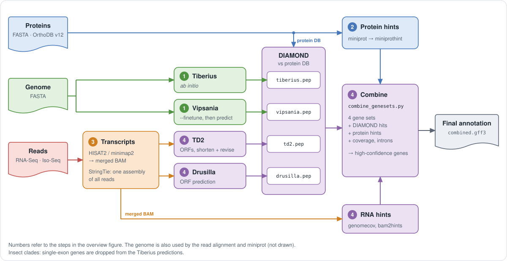

# Drusilla in the combined HC flow

Drusilla is one of the two ORF callers of step 4 of the pipeline (see the
[overview](../README.md#what-the-pipeline-does)); the other is TD2. In every
evidence run (`rnaseq`, `isoseq`, `mixed`), Drusilla predicts the ORFs on
the StringTie assembly, and `combine_genesets.py` integrates its ORFs with
the Tiberius, Vipsania and TD2 gene sets. The dedicated "Drusilla flow"
with its LightGBM filter and hint rescue has been retired; `combine_genesets.py`
replaces the per-model filtering it used to do.

<p align="center">
  
</p>

## Steps that run Drusilla

1. **`FILTER_STRINGTIE`**: the StringTie assembly is filtered by length,
   coverage and TPM: default `min_length: 300`, `min_cov: 3`, `min_tpm: 1`
   (and `min_tpm_long: 0.5` for transcripts of at least `long_length: 3000`
   nt). Transcripts with strand `.` (no spliced reads, almost all
   single-exon) are dropped by default (`drop_unstranded: true`); their
   Drusilla ORFs were mostly not genes on *T. rubripes* (gene F1 76.36 with
   them, 76.55 without).
2. **`DOWNLOAD_DRUSILLA_MODEL`**: the released model (`vertebrates` or
   `insects`, from the clade's `drusilla_model` in
   [`conf/hc_genes.yaml`](../conf/hc_genes.yaml), or `drusilla.model`) is
   downloaded once on the submitting host and checked against its
   `weights_sha256`. The GPU nodes need no internet. With `cache_dir`,
   Drusilla takes the model from that cache instead (`drusilla models
   download <model>` with `DRUSILLA_CACHE_DIR` set to it fills it once).
3. **`DRUSILLA_ANNOTATE`**: `drusilla annotate` predicts the ORFs of the
   kept transcripts, including ORFs truncated at the 3' or 5' end of a
   transcript. `shards > 1` splits the transcripts by gene into that many
   processes, which is useful on CPU nodes where one process uses only one
   to two cores (for example `shards: 24` on a 48-core CPU node).
4. **`COLLAPSE_ORFS`**: isoforms whose CDS is a subsequence of another one
   are dropped (`drusilla filter-subseq`). The result is
   `intermediate/drusilla_orfs.gtf`, which `combine_genesets.py` reads as
   `--drusilla`.

## Params

```yaml
drusilla:
  model: null              # null = drusilla_model of the clade in conf/hc_genes.yaml
  weights: null            # a local .weights.h5 instead (needs config)
  config: null
  cache_dir: null          # model cache (DRUSILLA_CACHE_DIR); null = downloaded once on the submitting host
  batch_size: null         # null = Drusilla sizes the batch from the GPU memory
  shards: 1                # parallel Drusilla processes; e.g. 24 on a 48-core CPU node
  min_coding_length: 200   # minimal CDS length of a Drusilla ORF
  min_length: 300          # StringTie pre-filter
  min_cov: 3
  min_tpm: 1
  long_length: 3000
  min_tpm_long: 0.5
  drop_unstranded: true    # drop transcripts with strand '.' (no spliced reads)
```

See [parameters.md](parameters.md#drusilla) for the full table.

Drusilla runs on a GPU (label `gpu`) in the Drusilla image. Without a GPU,
send `DRUSILLA_ANNOTATE` to CPU nodes in your site config and set `shards`:
on *Bos taurus* 24 shards used 26 of 48 cores and 40 GB.

## Known clades in `conf/hc_genes.yaml`

| Clade | `drusilla_model` | Notes |
| --- | --- | --- |
| Vertebrata | `vertebrates` | |
| Mammalia | `vertebrates` | |
| Insecta | `insects` | combine_genesets.py also gets `--drop-lone-single-exon tiberius` |
| Lepidoptera | `insects` | combine_genesets.py also gets `--drop-lone-single-exon tiberius` |

When a Drusilla model is released for another clade, add the clade to
`conf/hc_genes.yaml` with its `drusilla_model` (and `recommended` for the
warning that fires on runs that differ from it). For a clade without a
table entry, set `drusilla.model` to pick a Drusilla model.

## Insects

For insect runs the recommended flow is Vipsania with the model `Insecta`,
fine-tuned on the genome (`vipsania.finetune: true`, default), RNA-Seq or
Iso-Seq, and protein evidence. The `target_species` of the gene-finder
model decides whether `combine_genesets.py` receives
`--drop-lone-single-exon tiberius`: both the Tiberius `insecta` /
`lepidoptera` models and the Vipsania `Insecta` model trigger it.

```yaml
genome: /abs/path/genome.fa
rnaseq_bam: [/abs/path/VARUS.bam]
proteins: /abs/path/proteins.faa
tiberius:
  model_cfg: insecta
vipsania:
  model: Insecta
  finetune: true
```

```bash
paludamentum --nf_config local --genome genome.fa \
    --model_cfg insecta --model Insecta --proteins proteins.faa --rnaseq_bam VARUS.bam
```

The Drusilla model `insects` (epoch 51 of the training run
`cnn_lstm_run006_insects`, Lars Gabriel) is downloaded once, like the
vertebrate model. Vipsania fine-tune runs as one GPU task on the whole
genome; on the 11 insect genomes below it took 3.8 to 4.5 h on one A100,
with 256 GB of memory requested.

A run of an insect model that differs from the clade's `recommended` entry
in `conf/hc_genes.yaml` gets a warning in the Nextflow log that names each
difference (Vipsania not fine-tuned, no RNA-Seq or Iso-Seq, no protein
evidence); the run itself goes on.

### Historical insect benchmark (pre-combine flow)

The following numbers come from the pre-combine insect flow (just the merge
of Drusilla ORFs with Vipsania predictions, without `combine_genesets.py`).
They are kept as a lower bound for the combined flow. Mean gene F1 of
`gffcompare --strict-match -e 3 -T` on the CDS against the RefSeq
annotation of 11 insects (*Bombyx mori*, *Cataglyphis hispanica*, *Colias
croceus*, *Danaus plexippus*, *Drosophila melanogaster*, *Leptidea
sinapis*, *Nymphalis io*, *Osmia bicornis*, *Tribolium castaneum*,
*Vanessa cardui*, *Zerene cesonia*). Gene sets made with the standalone
tools by Lars Gabriel, merged with `merge_annotations.py --mode full`,
evaluated with gffcompare 0.12.10:

| Gene set | Needs proteins | Gene F1 |
| --- | --- | --- |
| **Drusilla ORFs + Vipsania, no filter** | no | **75.20** |
| BRAKER3 | yes | 75.40 |
| Drusilla ORFs + Vipsania, LightGBM filter (retired) | yes | 70.06 |
| Drusilla ORFs + Tiberius, no filter | no | 65.98 |
| Drusilla ORFs alone | no | 64.80 |
| Vipsania alone (fine-tuned) | no | 60.40 |
| Tiberius alone | no | 57.62 |

The combined HC flow (step 4 of today's pipeline) merges all four sets
(Tiberius, Vipsania, revised TD2, Drusilla) with the four DIAMOND tables,
miniprot and miniprothint, coverage and introns. Benchmarks of the
combined flow will be added as they are measured.

## Known issues

- Benchmarks of `combine_genesets.py` against the historical pre-combine
  insect flow are not yet published. The combined flow is expected to be at
  least as accurate because it keeps the same Drusilla ORFs on the same
  StringTie assembly.
- The Drusilla model `insects` is from the training run
  `cnn_lstm_run006_insects`; the LightGBM filter was retired because it
  lowered the F1 on insects (see table above).
