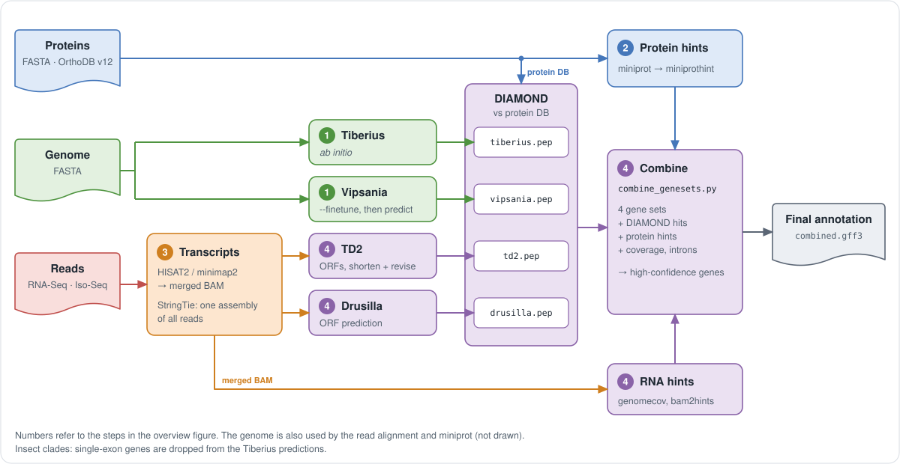

# Drusilla in the combined HC flow

Drusilla is one of the two ORF callers of step 4 of the pipeline (see the
[overview](../README.md#what-the-pipeline-does)); the other is TD2. In every
evidence run (`rnaseq`, `isoseq`, `mixed`), Drusilla predicts the ORFs on
the StringTie assembly, and `combine_genesets.py` integrates its ORFs with
the Tiberius, Vipsania and TD2 gene sets (by default selecting the
structures with a learned classifier, with the tier rules as fallback, see
the [README](../README.md#combined-hc-flow)). The dedicated "Drusilla flow"
with its LightGBM filter and hint rescue has been retired; `combine_genesets.py`
replaces the per-model filtering it used to do.

<p align="center">
  
</p>

## Steps that run Drusilla

1. **`STRAND_FIX_BAM`** (part of `RNASEQ_EVIDENCE`, before the StringTie
   assembly, not of the Drusilla flow proper): `drusilla strand-fix-bam`
   infers the library protocol of each run in a short-read BAM from its
   spliced reads and sets the `XS` tag on all reads of stranded runs, so
   StringTie assigns a strand to single-exon transcripts and separates
   antisense neighbours. It runs on every HISAT2 BAM (one library, run regex
   `none`) and on every user BAM (`rnaseq_bam`), where the run ids come from
   the read names (`strand_fix_run_regex`, default: Drusilla's). It is on by
   default and off with `strand_fix: false`. The per-BAM report is
   `intermediate/strand_fix/<bam>.strand_runs.tsv`. Iso-Seq BAMs are not
   changed, and pyVARUS directories bring no BAM, so the strand fix cannot
   run on them.
2. **`FILTER_STRINGTIE`**: the StringTie assembly is filtered by length,
   coverage and TPM: default `min_length: 300`, `min_cov: 3`, `min_tpm: 1`
   (and `min_tpm_long: 0.5` for transcripts of at least `long_length: 3000`
   nt). Transcripts with strand `.` (no spliced reads, almost all
   single-exon) are kept by default (`drop_unstranded: false`) and scanned
   on both strands (`unstranded_both_strands: true`, see below). With
   `drop_unstranded: true` they are dropped. That was the default for
   Drusilla 0.1, because their ORFs were mostly not genes on *T. rubripes*
   (gene F1 76.36 with them, 76.55 without). That comparison was made
   without both-strand scanning, which Drusilla 0.1 did not have.
3. **`DOWNLOAD_DRUSILLA_MODEL`**: the released model (`drusilla.model`,
   default `drusilla_model`, the one model of all clades; `vertebrates` and
   `insects` can be set) is downloaded once on the submitting host and checked against its
   `weights_sha256`. The GPU nodes need no internet. With `cache_dir`,
   Drusilla takes the model from that cache instead (`drusilla models
   download <model>` with `DRUSILLA_CACHE_DIR` set to it fills it once).
4. **`DRUSILLA_ANNOTATE`**: `drusilla annotate` predicts the ORFs of the
   kept transcripts. A flank of 500 bp of genome is added on both sides of
   every transcript, so ORFs truncated at the 5' or 3' end of a transcript
   are completed into it; they carry the GTF attribute
   `completion "5p|3p|5p3p"`. The subsequence collapse of `annotate` is off
   (`--no-subseq-collapse`) because step 5 does it. `shards > 1` splits the transcripts by gene into that many
   processes, which is useful on CPU nodes where one process uses only one
   to two cores (for example `shards: 24` on a 48-core CPU node).
5. **`COLLAPSE_ORFS`**: isoforms whose CDS is a subsequence of another one
   are dropped (`drusilla filter-subseq`, the same function and tolerances
   as the built-in collapse of `annotate`, plus a report of the dropped
   isoforms). The result is
   `intermediate/drusilla_orfs.gtf`, which `combine_genesets.py` reads as
   `--drusilla`.

## Params

```yaml
drusilla:
  model: drusilla_model    # one model for all clades; vertebrates / insects also released
  weights: null            # a local .weights.h5 instead (needs config)
  config: null
  cache_dir: null          # model cache (DRUSILLA_CACHE_DIR); null = downloaded once on the submitting host
  batch_size: null         # null = Drusilla sizes the batch from the GPU memory
  shards: 1                # parallel Drusilla processes; e.g. 24 on a 48-core CPU node
  min_coding_length: 200   # minimal CDS length of a Drusilla ORF
  min_length: 300          # StringTie pre-filter
  min_cov: 3
  min_tpm: 1
  long_length: 3000
  min_tpm_long: 0.5
  drop_unstranded: false   # true = drop transcripts with strand '.' (no spliced reads)
  unstranded_both_strands: true   # scan both strands of '.' transcripts (needs drop_unstranded: false)
  flank_bp: 500            # bp of genomic context per transcript side, ORF completion into it; null/0 = off
  flank_3p_bp: null        # 3' side alone (enough on its own); null = flank_bp (500)
  flank_min_tx_frac: null  # minimal fraction of an ORF inside the transcript; null = Drusilla's default (0.5)
  orfs_per_tx: null        # ORFs per transcript, longest first; null = Drusilla's default (1), 0 = all
strand_fix: true           # top level: strand recovery of the short-read BAMs
strand_fix_run_regex: null # top level: run id regex for user BAMs; null = Drusilla's default
```

See [parameters.md](parameters.md#drusilla) for the full table.

## Unstranded, truncated and fused transcripts

StringTie leaves single-exon transcripts without spliced reads unstranded
(strand `.`), and its assemblies can hold transcripts that are truncated at
the 3' end or fused from several genes. Drusilla 0.2 has three mechanisms
for these cases, set with the `drusilla.*` params. The first two are on by
default, the third is off:

| Param | Drusilla flag | Effect |
| --- | --- | --- |
| `drop_unstranded: false`, `unstranded_both_strands: true` (default) | `--unstranded-both-strands` | Transcripts with strand `.` are kept and scanned on both strands. The reverse complement is scanned as `<tid>__rc`, and the orientation with the longer ORF is kept. |
| `flank_bp: 500`, `flank_3p_bp`, `flank_min_tx_frac` (default) | `--flank-bp N --flank-3p-bp M --flank-keep [--flank-min-tx-frac F]` | Genomic context of `flank_bp` bp is added on both sides of every transcript (`flank_3p_bp` sets the 3' side alone, default `flank_bp`), so ORFs cut off at a transcript end are completed into it and get the attribute `completion "5p\|3p\|5p3p"`. ORFs with less than `flank_min_tx_frac` (default 0.5) of their CDS inside the transcript are dropped. |
| `orfs_per_tx: K` (default `null` = 1) | `--orfs-per-tx K` | Up to `K` ORFs per transcript, longest first (`0` = all), for fused transcripts. |

`unstranded_both_strands` only acts on transcripts that reach Drusilla, so
it needs `drop_unstranded: false`. With `drop_unstranded: true` the run logs
a warning and the option has no effect. The flank options are passed when
`flank_bp` or `flank_3p_bp` is greater than 0. All three need Drusilla 0.3.0
(branch `strand`), the image the pipeline runs; it also takes the assembly as
`--assembly-gtf`.

The mechanisms were developed on fungal genomes, where unstranded
single-exon transcripts, 3'-truncated transcripts and fused transcripts are
common. The defaults are the set that was tested with good accuracy on
several species across clades. They have not been compared head-to-head with
other settings yet. They stay the standard: a change of a default needs a
measured accuracy gain. The strand fix (`strand_fix`) is the BAM-level
complement for the unstranded transcripts: it gives StringTie the strand
before the assembly.

Example for fused transcripts (all ORFs per transcript):

```yaml
drusilla:
  orfs_per_tx: 0
```

To turn the defaults off (Drusilla 0.1 behavior):

```yaml
drusilla:
  drop_unstranded: true
  unstranded_both_strands: false
  flank_bp: 0
```

Drusilla runs on a GPU (label `gpu`) in the Drusilla image. Without a GPU,
send `DRUSILLA_ANNOTATE` to CPU nodes in your site config and set `shards`:
on *Bos taurus* 24 shards used 26 of 48 cores and 40 GB.

## Known clades in `conf/hc_genes.yaml`

| Clade | `classifier_clade` | Notes |
| --- | --- | --- |
| Vertebrata | `vertebrates` | |
| Mammalia | `vertebrates` | |
| Insecta | `insects` | combine_genesets.py also gets `--drop-lone-single-exon tiberius` |
| Lepidoptera | `insects` | combine_genesets.py also gets `--drop-lone-single-exon tiberius` |
| Mesangiospermae | `embryophyta` | Tiberius angiosperms model |
| Fungi | `fungi` | Tiberius fungi model |

The table does not choose the Drusilla model; all clades use
`drusilla.model` (default `drusilla_model`). To add a clade, add it to
`conf/hc_genes.yaml` with its `classifier_clade` (and `recommended` for the
warning that fires on runs that differ from it). A clade without
`classifier_clade`, or not in the table, is new to the combine classifier
(`combine.classifier`, default on): the pipeline passes `--unknown-clade`
and the locus threshold rises from 0.25 to 0.30. This holds for the
Tiberius chlorophyta and diatoms models (Chlorophyta, Bacillariophyta),
which are not listed because the classifier never saw them.

## Insects

For insect runs the recommended flow is Vipsania with the model `Insecta`,
fine-tuned on the genome (`vipsania.finetune: true`, default), RNA-Seq or
Iso-Seq, and protein evidence. The `target_species` of the gene-finder
model decides whether `combine_genesets.py` receives
`--drop-lone-single-exon tiberius`: both the Tiberius `insecta` /
`lepidoptera` models and the Vipsania `Insecta` model trigger it.

```yaml
genome: /abs/path/genome.fa
rnaseq_bam: [/abs/path/VARUS.bam]
proteins: /abs/path/proteins.faa
tiberius:
  model_cfg: insecta
vipsania:
  model: Insecta
  finetune: true
```

```bash
paludamentum --nf_config local --genome genome.fa \
    --model_cfg insecta --model Insecta --proteins proteins.faa --rnaseq_bam VARUS.bam
```

The Drusilla model `insects` (epoch 51 of the training run
`cnn_lstm_run006_insects`, Lars Gabriel) is downloaded once, like the
vertebrate model. Vipsania fine-tune runs as one GPU task on the whole
genome; on the 11 insect genomes below it took 3.8 to 4.5 h on one A100,
with 256 GB of memory requested.

A run of an insect model that differs from the clade's `recommended` entry
in `conf/hc_genes.yaml` gets a warning in the Nextflow log that names each
difference (Vipsania not fine-tuned, no RNA-Seq or Iso-Seq, no protein
evidence); the run itself goes on.

### Historical insect benchmark (pre-combine flow)

The following numbers come from the pre-combine insect flow (just the merge
of Drusilla ORFs with Vipsania predictions, without `combine_genesets.py`).
They are kept as a lower bound for the combined flow. Mean gene F1 of
`gffcompare --strict-match -e 3 -T` on the CDS against the RefSeq
annotation of 11 insects (*Bombyx mori*, *Cataglyphis hispanica*, *Colias
croceus*, *Danaus plexippus*, *Drosophila melanogaster*, *Leptidea
sinapis*, *Nymphalis io*, *Osmia bicornis*, *Tribolium castaneum*,
*Vanessa cardui*, *Zerene cesonia*). Gene sets made with the standalone
tools by Lars Gabriel, merged with `merge_annotations.py --mode full`,
evaluated with gffcompare 0.12.10:

| Gene set | Needs proteins | Gene F1 |
| --- | --- | --- |
| **Drusilla ORFs + Vipsania, no filter** | no | **75.20** |
| BRAKER3 | yes | 75.40 |
| Drusilla ORFs + Vipsania, LightGBM filter (retired) | yes | 70.06 |
| Drusilla ORFs + Tiberius, no filter | no | 65.98 |
| Drusilla ORFs alone | no | 64.80 |
| Vipsania alone (fine-tuned) | no | 60.40 |
| Tiberius alone | no | 57.62 |

The combined HC flow (step 4 of today's pipeline) merges all four sets
(Tiberius, Vipsania, revised TD2, Drusilla) with the four DIAMOND tables,
miniprot and miniprothint, coverage and introns. Benchmarks of the
combined flow will be added as they are measured.

## Known issues

- Benchmarks of `combine_genesets.py` against the historical pre-combine
  insect flow are not yet published. The combined flow is expected to be at
  least as accurate because it keeps the same Drusilla ORFs on the same
  StringTie assembly.
- The Drusilla model `insects` is from the training run
  `cnn_lstm_run006_insects`; the LightGBM filter was retired because it
  lowered the F1 on insects (see table above).
